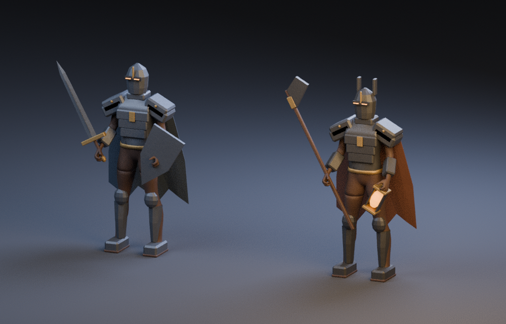
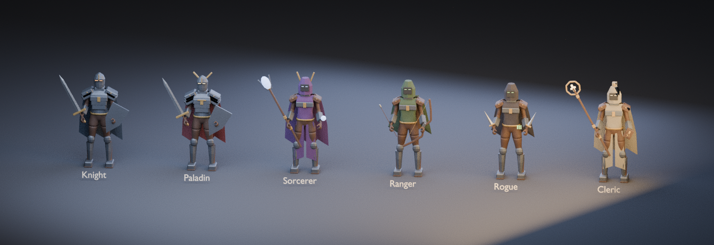
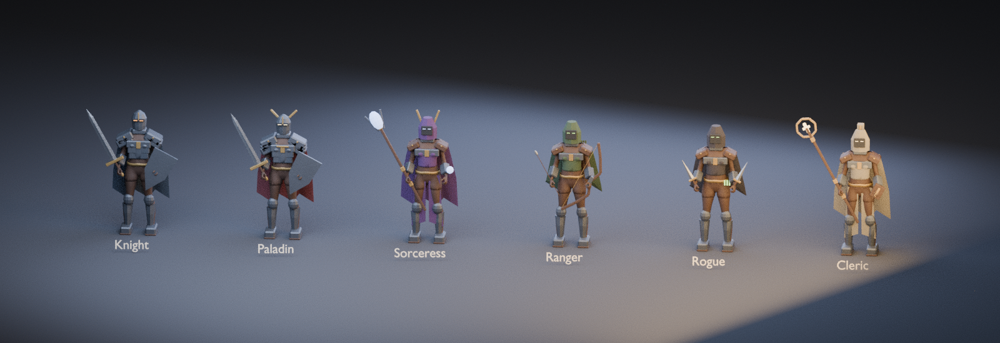
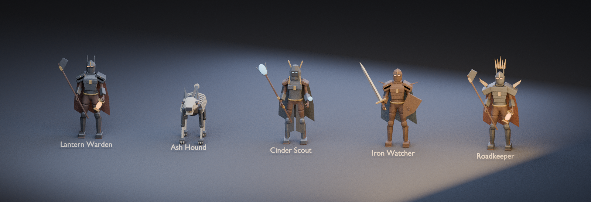

# Ashlight: mobile 3D combat starter

An original combat prototype inspired by reactive turn-based RPGs. All six hero classes now use stylized dark fantasy armor and a generated ruined courtyard. All campaign enemies use themed enemy models. No Clair Obscur assets, names, music, or story are included.

## Open and play

1. Install Unity Hub and Unity **6000.0.65f1** with **Web Build Support (WebGL)** for browser testing on iPhone from Windows. Android Build Support is optional for Android APKs.
2. Open this `MobileGame` directory as a Unity project. Allow package import to finish.
3. The editor helper creates `Assets/Scenes/Battle.unity` and registers it for builds. If necessary select **Ashlight > Prepare Mobile Project**. Open that scene, then press Play.
4. The game opens on the **Chapters** menu. Select the unlocked chapter, then use **Attack**, either equipped skill, or **Auto Play**. Defense rolls automatically using each class’s dodge and parry chances. Mouse clicks work in the editor; buttons accept touch on devices.

The combat presentation includes health bars, attack lunges, enemy windup, dodge motion, and parry/counter feedback. Rowan and the Lantern Warden now use armored models with basic combat animation; all campaign encounters have enemy visuals. Safe-area bounds update when the window or phone orientation changes. New presentation and touch-down behavior require Unity/device validation.

The scene starts empty intentionally: `Prototype` generates the camera, lighting, arena, characters, event system, and HUD at runtime. Use the built-in rendering pipeline. The UI uses the legacy input module; keep Active Input Handling set to **Input Manager (Old)** or **Both**. Landscape orientation and safe-area bounds are configured for the prototype. Device cutouts, aspect ratios, timing feel, and actual rendering need device testing.

## Stylized dark fantasy reference

Rowan (Common Knight) and the first enemy, Lantern Warden, wear original angular armor, closed helmets, tattered capes, and muted metal. The Warden carries a halberd and glowing lantern. A torchlit ruined courtyard, lower camera, staggered party positions, charcoal HUD and compact health bars establish the new direction. All six hero classes now have male and female dark fantasy variants. All five chapter-one enemies and the paired bosses from chapter three onward now have modeled visuals; all campaign enemies have modeled visuals. The built-in rendering pipeline is retained.

To update an existing Unity project:

1. Copy **Assets/Art**, the updated **Assets/Editor** and **Assets/Scripts** from this version. Keep your existing project settings and saves.
2. Wait for importing, then run **Ashlight > Prepare Mobile Project**.
3. Run **Ashlight > Art > Build Dark Fantasy Roster** to refresh all twelve class/gender models. Use **Build Dark Fantasy Reference** only if Rowan or the Warden also need refreshing. Automatic preparation preserves existing generated prefabs.
4. Open the Battle scene and press Play. Select Rowan in your party and start the first chapter. Saves that completed the original six chapters continue into chapter 7 with their collection and currency intact.



The class roster uses the existing hero gender assignments (18 women and 12 men). Paladins wear winged helmets and wine-colored capes; Sorceress/Sorcerer carry crystal staves and crowned cowls; Rangers carry recurve bows, arrows and quivers; Rogues carry twin leaf daggers and poison vials; Clerics carry halo staves, prayer books and ash-colored split vestments. Knights retain the sword and kite shield. Classes share basic armor construction; individual named heroes do not yet have unique art or rarity-specific outfits.




Named hero prefabs still take priority. Otherwise, hero loading now uses `Resources/Heroes/DarkFantasy/<class>_<gender>`, then the legacy class/gender prefab as fallback. The new generated folder preserves existing custom and legacy prefabs. Characters still use basic animation; Ranger and Rogue attacks and caster staff motions have distinct poses.

These are Blender character art previews, not Unity screenshots; they do not show the courtyard or HUD. The free CC0 source and original asset details are in [DarkFantasy/CREDITS.md](Assets/Art/DarkFantasy/CREDITS.md).

Validation: **2,100 combat checks passed**. The twelve new class FBX files independently reimported with weighted meshes, UVs, the 53-bone skeleton and seven animation states; each is below 18,000 triangles and uses at most seven material slots. All three textures are 512×512 and their checksums match. Unity is unavailable in this environment, so Unity compilation, import, Play mode, clipping, camera framing and mobile performance require local verification.

## Enemy art and paired bosses

Chapter one keeps its five encounters: **Lantern Warden**, **Ash Hound**, **Cinder Scout**, **Iron Watcher**, and **Roadkeeper**. The Warden sweeps its halberd; the Hound is an original skeletal quadruped with a jaw, articulated legs and tail; the Scout wears a shadowed cowl and casts a frost effect from range; the Watcher has rusted spiked armor and a longer sword; the Roadkeeper has a crown, larger mantle and a heavy slam. Each model includes a separate Windup pose before the timed defense flash. Boss strikes add a pooled floor shockwave and sparks.



The image is a Blender character preview, not a Unity gameplay screenshot. Six source models are included (five chapter-one models plus a female hooded caster base). Later boss prefabs reuse these sources with chapter-specific cloaks and effects; they do not yet have eight unique meshes.

Starting with **chapter 3**, each chapter's fifth encounter has **two bosses on the field together**:

| Chapter | Boss pair |
| --- | --- |
| 3 — The Ember Citadel | Cinder Sovereign + Ashen Marshal |
| 4 — The Storm Spire | Storm Regent + Stormbound Executioner |
| 5 — The Blighted Garden | Thorn Queen + Rotbound Consort |
| 6 — The Eclipse Throne | Veiled Monarch + Eclipse Harbinger |

Both bosses have separate health and elemental weaknesses. Tap a boss's name in the compact header to choose the target during your turn. A defeated target automatically switches to a surviving boss. Each living boss attacks once per enemy round, with its own windup and dodge/parry window; parries counter the attacking boss regardless of your selected target. Victory and the usual 50-crystal reward occur once, after both bosses fall. The companion boss has 70% of the primary boss's maximum health and swaps its weakness/resistance, making target choice useful. Boss attack effects are presentation; damage and hero defense rules remain the existing fixed strike/guard system.

Chapters 1–2 keep one boss in the final encounter. There are still 30 encounters and at most five party heroes. Save format and encounter indices are unchanged: existing progress, recruits, loadouts and currency remain compatible. Reloading a fight starts its full encounter; a saved pending victory remains cleared. Other encounters outside this art pass retain their previous placeholder models.

To update:

1. Stop Play mode and copy **Assets/Art**, **Assets/Editor**, and **Assets/Scripts** from the updated branch. Copy all script files, including `EnemyVisualDefinition.cs`.
2. Wait for Unity to compile/import, then run **Ashlight > Prepare Mobile Project** followed by **Ashlight > Art > Build Enemy Roster**. This explicitly refreshes enemy prefabs/controllers, including the Warden's new Windup animation. Existing custom hero prefabs are preserved. The older **Build Chapter One Enemies** menu is an alias for the same operation.
3. Press Play and try chapter one. In chapter three's final encounter, select each boss, damage one, and check both attack turns. Also check that killing one leaves the other alive and that each parry counters the flashing attacker. Progress continues through twelve chapters; campaign restart has been removed.

**Verified here:** 2,100 combat checks, including all four paired encounters through the public combat API, defeat order, independent defense windows, counters, fallen allies, reset, save/reload and one reward per encounter. The six enemy source FBX files independently reimported in Blender with fully weighted meshes, UVs, eight animation states and evaluated finite pose bounds. Each has fewer than 18,000 triangles and at most seven material slots. Source reports and checksums are in [DarkFantasy/CREDITS.md](Assets/Art/DarkFantasy/CREDITS.md). **Unity compilation/import, gameplay rendering, two-boss camera framing, clipping and device performance remain unverified in this cloud environment.**

## iPhone browser testing from Windows

This route uses Safari, without Xcode or a native app installation. Unity's mobile Web support varies by browser/device; use a recent iPhone with updated Safari. Real device validation is required.

1. In Unity Hub > Installs > your editor > Add modules, install **Web Build Support** (sometimes labeled WebGL Build Support).
2. Stop Play mode. Select **Ashlight > Browser > Configure Browser**, wait for importing, then select **Ashlight > Browser > Build Browser Game**.
3. A successful build creates `Builds/Browser/index.html` plus the `Build` folder. The custom template supplies a touch-friendly launch screen, landscape reminder, safe-area margins, loading progress, and error messages. Builds disable compression so static hosting does not require special compression headers.
4. Host the **entire `Builds/Browser` folder** with a static website host, such as Netlify's manual deploy, then open its HTTPS URL in Safari on your phone. Hosting uploads your game publicly; review the files and choose your host before uploading. No site has been published automatically.
5. Rotate the iPhone sideways and tap Play. Choose the unlocked chapter to enter the next encounter. Try attacks, automatic defense, Auto Play, victory/defeat, and restart. Also check Safari's toolbar, orientation changes, and returning from the background.

For local testing instead of public hosting, install Python 3 on Windows, open a terminal in `Builds/Browser`, and run:

```powershell
py -m http.server 8000 --bind 0.0.0.0
```

Keep PC and iPhone on the same trusted Wi-Fi network. Run `ipconfig` on Windows to find the PC's Wi-Fi IPv4 address; open `http://YOUR-PC-IP:8000` in Safari. If Windows Firewall asks, allow Python on **Private networks only**. `localhost` on the phone refers to the phone, not the PC. Stop the server with Ctrl+C when finished. Guest Wi-Fi/client isolation may prevent access. Do not open `index.html` directly with a file URL.

Existing ZIP users: download the updated GitHub branch into a **separate directory**, then open its `MobileGame` folder through Unity Hub. Preserve your existing local scene/settings. To update an existing project without replacing it, copy `Assets/Editor/BrowserBuild.cs` and the whole `Assets/WebGLTemplates/MobileSafari` directory into the same paths in your local project; allow Unity to import them.

The build helper and template are source changes only: Unity Web compilation and iPhone Safari behavior have not been verified in this cloud machine. Combat logic checks still pass; your existing editor play test does not validate the Web build.

## Android first: build and test

1. In Unity Hub, add **Android Build Support**, including **Android SDK & NDK Tools** and **OpenJDK**, to the pinned editor. Use Unity's bundled tools rather than the cloud machine's Java 21.
2. In the editor select **Ashlight > Android > Configure Android**. Allow the platform switch/import to finish; run it again if Unity requests an import restart.
3. Select **Ashlight > Android > Build Test APK**. The helper explicitly includes the Battle scene and builds `Builds/Android/Ashlight.apk`. It reports failed builds as errors. Configuration uses IL2CPP, ARM64, Android 8.0 or later, landscape, and legacy touch input.
4. On an ARM64 Android phone, enable Developer options and USB debugging. Connect the phone, approve its debugging prompt, and run these commands using the `adb` shipped with Unity's Android SDK:

```bash
adb devices
adb install -r Builds/Android/Ashlight.apk
adb shell monkey -p com.ashlightstudio.ashlight -c android.intent.category.LAUNCHER 1
```

Alternatively, use Unity's Android Build And Run with the connected phone selected. These are development builds; publishing requires a unique application identifier, release settings, your own signing keystore, and store setup. `com.ashlightstudio.ashlight` is a placeholder.

For an activated Unity editor with Android modules installed, build from a terminal:

```bash
/path/to/Unity -batchmode -quit -projectPath "$PWD" -buildTarget Android -executeMethod AndroidBuild.BuildTestApk -logFile android-build.log
```

### First device acceptance check

- Arena, hero, enemy, health, and buttons appear in landscape without overlapping the phone cutout.
- Each living hero acts once per round. Basic attack damage depends on hero stats and the enemy elemental matchup. No hero can act during the enemy turn.
- Dodge during FLASH prevents damage; a prompt parry prevents damage and counters with elemental damage. Missing defense costs up to 35 health; guard reduces it.
- Win by defeating the enemy; lose when all active heroes are defeated. Restart cancels a pending enemy turn. Continue after victory advances recruitment.
- Test repeated restarts, background/resume, and screen locking. Timing feel, frame rate, and UI layout remain unverified on devices.

No APK has been built in this cloud workspace: Unity, its Android modules, and editor activation are unavailable here. The scripts prepare the build path but require an actual Unity build and phone test.

## iPhone

On **macOS**, switch the build profile to iOS and export an Xcode project. Open it in Xcode, select your signing team and unique bundle identifier, and run on a connected iPhone. App Store distribution requires Apple Developer membership. This Linux cloud machine cannot build/sign the iOS app.

## Validation and current limits

The engine-independent combat model passes 1,513 checks covering party turns, the five-hero cap, recruitment, all 36 skills, two-skill loadouts, healing/guard, rarity scaling, elemental overrides, defense, victory/defeat, save restoration, chapter progression, and reset. To rerun in the prepared cloud machine:

```bash
source /workspace/.yorgame-tools/activate
mcs -out:/tmp/ashlight-checks.exe Assets/Scripts/Battle.cs Assets/Scripts/Battle.Activities.cs Assets/Scripts/Battle.Recommendations.cs Assets/Scripts/Battle.Seasonal.cs Assets/Scripts/Battle.Journey.cs Assets/Scripts/Battle.Advanced.cs Assets/Scripts/BossPresentation.cs Assets/Scripts/BetaSupport.cs Assets/Scripts/CharacterClass.cs Assets/Scripts/SkillDefinition.cs Assets/Scripts/HeroDefinition.cs Assets/Scripts/Elements.cs Assets/Scripts/ChapterDefinition.cs Assets/Scripts/EnemyVisualDefinition.cs Assets/Scripts/ProgressData.cs Assets/Scripts/Summoning.cs Assets/Scripts/CombatMotion.cs Assets/Scripts/AutoBattlePlanner.cs Assets/Scripts/EnemySkills.cs Assets/Scripts/UltimateDefinition.cs Assets/Scripts/GearDefinition.cs Assets/Scripts/BattleResults.cs Assets/Scripts/ChapterStageDefinition.cs Assets/Scripts/SkillPresentation.cs Validation/BattleChecks.cs
mono /tmp/ashlight-checks.exe
```

Unity is not installed in the onboarding machine. Unity script compilation, scene rendering, touch input, Android builds, and iOS builds have **not** been verified. Open in Unity to perform these checks before calling this a playable device build.

The existing Data.Layer project is separate and untouched. No backend or database is required. Further character art/animation, expanded audio, cloud save sync, accessibility settings, and performance tuning are future work. The development direction uses chapters rather than exploration.

## Updating an existing local copy

Stop Play mode. Copy **all** `.cs` files from this branch's `Assets/Scripts` into your local project's matching folder, including `CharacterClass.cs`, `HeroDefinition.cs`, `SkillDefinition.cs`, `Elements.cs`, `ChapterDefinition.cs`, `ProgressData.cs`, `ProgressStore.cs`, `Summoning.cs`, `CombatEffects.cs`, and `PressAction.cs`. Also copy the updated `Packages/manifest.json` so the JSON serialization module is enabled. Preserve your scene and settings. Unity will import the changes. Alternatively, extract the updated GitHub ZIP into a separate directory and open that `MobileGame` folder.

## Party, recruitment, and named heroes

Start with **Rowan**, a Common Knight. Each prototype victory recruits the next named hero when you press **Continue**. The first allies are Lucan (Paladin) and Elara (Sorceress). The active party never exceeds **five heroes**. Later recruits enter reserves; select a class button to open its named hero list. Selecting an active party member changes whose action you control. Selecting a recruited reserve replaces the currently selected party slot, before battle only. Two different named heroes of the same class can be in the party, but the same named hero cannot occupy two slots.

All living heroes receive one action before the enemy responds. Normal attacks favor living front-row allies, back-row strikes seek living back-row allies, and party-wide attacks hit everyone. Defeated allies cannot act. Party healing does not revive defeated allies. Full party defeat ends the battle.

The roster contains **30 named heroes**: five per class, across Common, Uncommon, Rare, Epic, and Legendary. Rarity scales base health, attack, skill damage, healing, and guard. This is a starting balance, not a final progression economy. See [HEROES.md](HEROES.md) for the complete roster and skill catalog.

Recruitment currently uses deterministic chapter victory rewards. There is no exploration area. Chapter progress, recruited named heroes, party slots, and active/reserve skill loadouts persist locally. Restart restores health and skill uses while retaining the roster and loadouts. A mid-battle reload starts that encounter fresh; a saved victory is processed once on the chapter menu, so its reward is retained.

## Equip two of six skills

Select a party hero through its class/hero list before battle, then press **Skills**. Select **Slot 1** or **Slot 2**, then choose from that class's six skills. The two slots must contain different skills. Press **Done** to return. Skill selection locks after combat begins. Both skill buttons appear beside the basic attack button; each has two independent uses per battle. Skills consume that hero's action. Higher rarity strengthens the same class skills rather than adding equipped slots.

## Elements and enemies

Named hero affinities follow class themes: Knight Physical/Fire; Paladin Fire/Light; Sorceress Cold/Lightning/Fire; Rogue Physical/Poison; Ranger Physical/Cold; Cleric Light. Basic attacks and skills without an explicit override use hero affinity. All current class skills have explicit affinities, independent of the named hero's basic attack affinity: Flame Lance uses Fire, Frost Ward uses Cold, Arcane Burst and Starfall use Lightning, and Frost Drain uses Cold. Some weapon skills use Physical, which is neutral against the current enemies. Skill affinity is displayed in the loadout panel.

Enemies show their weakness and resistance before you attack. Weakness multiplies damage by **1.5**; resistance by **0.5**; other damage is neutral. Damage is rounded, with at least one damage for a positive attack. Healing and guard are unaffected. Each chapter contains five uniquely named enemies with themed weaknesses/resistances; stage three reverses the usual matchup to encourage changing skill choices. Base health increases through the campaign (capped at 400), then scales to 1.33× in chapter 4 and 1.67× from chapter 5 onward. Stage five is a larger placeholder boss. These balance values remain provisional.

**Poison is currently an elemental damage type**, not a damage-over-time status. Burn, freeze, poison ticks, stun, cleanse, and revival are future mechanics. Explicit skill affinity overrides preserve their element across all rarity tiers.

## Validate the updated Unity presentation

The combat/roster model has been exercised outside Unity. The new UI, 3D party props, and builds remain unverified until opened in Unity. Check:

- Start shows the chapter menu, with Chapter 1 unlocked and later chapters locked. Choose Chapter 1; Rowan starts alone with two equipped skills.
- Win, Continue, and recruit Lucan, then Elara into reserves; additional active party slots unlock at chapters 2–5. Completing five stages unlocks Chapter 2.
- Each living hero acts once before the enemy attack; the targeted ally is identified.
- Skill selection rejects duplicates and cannot change during a fight.
- Recruit a reserve, select an active party slot, then replace it without exceeding five heroes.
- Named hero lists display rarity, affinity, scaled health/attack, and recruitment status.
- Weakness/resistance feedback agrees with the skill's shown element.
- Restart mid-attack cancels the old coroutine and preserves the roster/loadouts.

## Chapters and local saves

There are twelve chapters with five stages each. Only the current chapter is playable; earlier chapters show Completed and later chapters show Locked. Chapters 7–12 add simultaneous groups of two or three enemies per regular wave, with two bosses together at each chapter's end. The chapter menu shows six chapters per page and opens the page containing your current chapter. After stage 60 the story is complete; campaign restart is not available. Original completed saves continue at chapter 7. See [CHAPTERS.md](CHAPTERS.md) for the enemy list.

Progress uses Unity `PlayerPrefs` with versioned JSON and a previous valid snapshot as backup. Saves happen after summons, party/skill changes, victory, Continue, and on pause/focus loss/exit. Loading validates IDs, party size, unique members, recruited roster, skill choices, version, and stage bounds before applying anything. A valid backup is attempted if the primary save is unreadable. Each loaded encounter restores full health and skill uses. Unknown/incompatible snapshots are rejected rather than partially applied.

On Windows, saves are local to Unity's company/product preferences. On Web builds, they use browser storage for that website; clearing site data removes saves, private browsing may not retain them, and changing hosts does not transfer saves. This is **local saving, not cloud sync**. Unity storage behavior and the updated chapter UI require local verification; only the engine-independent snapshot/progression logic has been tested here.

Save keys are `Ashlight.Progress.v1` and `Ashlight.Progress.v1.backup`. For developers testing from a clean state, remove both keys in Unity deliberately; no automatic save deletion is performed during project updates.

All six classes use the included rigged male/female human meshes after project preparation. See the human character setup below.

## Free hero summons

The chapter menu has a **Summon — 100** button. New profiles start with **300 crystals**; each first stage clear grants **50 crystals** when you Continue. There are no purchases, ads, or real-money payments in this prototype.

| Rarity | Base chance | Duplicate crystal refund |
| --- | ---: | ---: |
| Common | 60% | 20 |
| Uncommon | 25% | 30 |
| Rare | 10% | 50 |
| Epic | 4% | 70 |
| Legendary | 1% | 90 |

Each rarity has six named heroes with equal conditional odds. Every fifth consecutive pull without Rare-or-better guarantees Rare-or-better; every fifteenth consecutive pull without Legendary guarantees Legendary. A naturally rolled better rarity is retained. Legendary pity takes priority. Any Rare/Epic/Legendary resets the Rare+ counter, and any Legendary resets the Legendary counter, including duplicates. The displayed numbers show how many pulls remain until each guarantee; pity means actual odds differ from the base rates near the thresholds.

Summons are available between encounters and after campaign completion, never during an active fight. Newly summoned heroes go to reserves, preserving the active party and its chapter-based five-hero cap. Duplicate heroes return the listed crystals without adding another copy. The result shows name, class, quality, affinity, and whether it is new or a duplicate. The hero pool remains fixed across chapters. Deterministic chapter rewards now award the first hero you do not own so a summon cannot cause a duplicated story reward.

Currency, recruits, and both pity counters save immediately. The version-2 snapshot accepts existing version-1 saves and gives those profiles the one-time 300-crystal starter balance on migration, preserving chapters/roster/loadouts. Save keys remain unchanged. Each cleared encounter awards crystals once when you Continue. Story rewards recruit missing named heroes until the collection is complete. Progress continues sequentially; campaign restart is no longer available.

Validation checks all probability boundaries, exact base-rate partition, both guarantees, duplicate refunds, invalid rolls, insufficient funds, rewards claimed once, save round trips, arbitrary summoned roster order, and legacy migration. The updated Unity summon screen and browser persistence still require local testing.

This is a local prototype, not a payment-ready economy. Real-money purchases would require store integrations and server-authoritative receipts, balances, hero ownership, and summon results.

## Combat effects

Attacks now render lightweight element-colored trails, impact bursts, and floating damage text (including Weak/Resist feedback). Fire creates orange embers; Cold creates stretched cyan shards; Poison uses green bubbles; Lightning draws a zigzag bolt; Light uses gold rings; Physical uses white trails and sparks. These are procedural prototype effects, not final authored assets.

Healing displays rising gold motes and the actual restored amount. Guard shows a ring and Guard label; a fully absorbed enemy hit shows Blocked. Successful dodge/parry has its own ring and label; parries also show the elemental counter hit. Impacts add a subtle, short vertical camera movement. None of these change battle damage or timing rules.

The effect pool is capped at 48 reusable objects with six shared colored materials. Restarts and chapter transitions clear effects and camera offsets. Preparation generates `Assets/Resources/CombatEffects.mat` referencing the built-in shader so Web/Android builds retain it. To update an existing project, copy **all scripts**, including the new `CombatEffects.cs`, and the updated **`Assets/Editor/ProjectSetup.cs`**, then choose **Ashlight > Prepare Mobile Project** before building.

The 1,513 engine-independent checks remain passing. Unity effect rendering has not been executed in this cloud environment. In local Play mode, verify each element, successful dodge/parry, healing, guard, restart while effects are active, and changing chapters. Phone/browser performance and shader inclusion still require a real build test.

## Battle HUD visibility

Hero selection, Skills, and Chapters appear only before the first action. Once combat starts, those controls disappear and heroes act in automatic party order. Restart is hidden throughout combat and returns after defeat; Continue appears after victory. Chapters also returns on the result screen. The selection overlay is closed whenever preparation ends. Attack, equipped skills, Auto Play, health, and automatic defense feedback remain on the battle HUD.

## Human character models

The project includes two adult human base models derived from MakeHuman/MPFB's CC0 anatomical mesh and skeleton, with original fitted clothing and basic animation. These replace the rejected procedural outfit figures. Preparation generates **12 class/gender prefabs**: Knight, Paladin, Sorceress, Ranger, Rogue, and Cleric, each with a male and female visual. Women have cropped fitted bodices/armor, shorts, and tall boots; men have broader shoulders and jawlines, short cropped hair, facial hair, higher-neck sleeveless cuirasses, shorts, and tall leg coverings. Sorceress/Cleric add split robe panels. Class colors and small bone-attached weapon props distinguish the six classes.

1. Download the updated project separately, or copy **Assets/ThirdParty/MakeHuman**, the updated **Assets/Editor** and **Assets/Scripts** folders into your current Unity project. Preserve your local scenes and settings. Delete the old `TemporaryOutfit.cs` script if updating files manually; it is no longer used.
2. Wait for Unity to finish importing the FBX files, then choose **Ashlight > Prepare Mobile Project**. The helper generates matching prefabs, materials, and two animation controllers in `Assets/Resources/Heroes`.
3. Open the battle scene and press Play. Rowan should now have an actual human mesh. Recruit/select a woman to see the female model. All genders use the same stats, skills, rarity rules, and progression.
4. **When updating from the earlier human models, choose Ashlight > Characters > Build Realistic Humans after the FBX import.** This refreshes the generated material slots, including facial hair. If a human prefab is missing, choose **Ashlight > Characters > Build Realistic Humans**. This explicitly rebuilds class/gender prefabs; automatic preparation preserves existing prefabs. A missing model shows a neutral capsule and a Console warning rather than the old outfit figures.

Models have faces, fingers, natural proportions, a 53-bone skeleton, opaque mesh clothing, and seven basic states: Idle, Attack, Cast, Dodge, Parry, Hit, Death. Root motion is disabled. A named prefab at `Resources/Heroes/Named/<hero-id>.prefab` still takes priority over a class/gender prefab. These older base models are retained as fallback assets. Dark fantasy class/gender models now take priority for named heroes without custom prefabs; unique faces, detailed skin/hair textures, polished animation and weapon meshes remain future art work. These are simple human models, not film-quality or photorealistic characters.

The 30 authored hero profiles include 18 women and 12 men, all adults ages 24–52. Stable IDs and gameplay are unchanged. Men in the Sorceress class display as Sorcerer; its class-selection button reads Sorcery.

**Verified here:** both FBX exports were independently reimported in Blender to check mesh budget, skeleton/hand attachments, weighted meshes, material roles, and all seven animation states. A Blender render was inspected for proportions and wardrobe fit. The asset report, source revision, license and checksums are in [Assets/ThirdParty/MakeHuman/CREDITS.md](Assets/ThirdParty/MakeHuman/CREDITS.md). Regeneration and validation tools are in `Tools/`. **Unity compilation/import, animation playback, battle appearance and phone/browser performance remain unverified here.** Check floor contact, facing, weapon attachment, clothing clipping during each action, and returning to Idle in Play mode.

The older licensed KayKit cartoon asset remains archived in `Assets/ThirdParty/KayKit`, with its optional build menu, but is not selected by gameplay. Previously generated `Resources/Heroes/Knight.prefab` and its materials/controller are unused; remove them deliberately if you do not want them included in Resources builds. No user assets are deleted automatically.

Additional free garment candidates remain documented in [WARDROBE.md](WARDROBE.md). None of those downloaded community clothing packs is bundled in this version.

## Updating the expanded campaign

Copy updated **Assets/Scripts** and **Assets/Editor** into your Unity project. Wait for compilation, then run **Ashlight > Art > Build Enemy Roster** to generate themed variants for the new enemies using the existing free models. Chapter-seven continuation requires no save deletion. The diagnostic menu **Ashlight > Diagnostics > Check Save Serialization** includes original campaign completion and three-enemy stages without touching player saves.

## Combat motion, audio and Auto Play

Copy the updated `Assets/Scripts`, `Assets/Editor`, `Assets/Art` and **`Assets/Resources/Audio`** into your Unity project. Wait for import/compilation, then run **Ashlight > Art > Refresh Combat Presentation** and press Play. This rebuilds the generated class/gender, Rowan and enemy controllers/prefabs; other custom named hero prefabs stay intact.

Class attacks now have anticipation, contact, follow-through and recovery: sword swings, heavier Paladin attacks, Rogue double strikes, Ranger bow release and caster charge/release. Enemy windup/strike poses, recoil, dodge, parry and death clips are updated. Impacts and 21 original free sound effects follow the contact frames; brief animator-only contact pauses do not stop the battle clock. Sound On/Off is on the chapter screen and persists across sessions.

Dodge and Parry buttons are removed. Defense automatically rolls once for each incoming strike, in manual and Auto Play modes. “Miss” means failed defense and normal incoming damage; Guard still reduces it. Current prototype probabilities (editable in `AutoBattlePlanner.DefenseChances`):

| Class | Dodge | Parry | Failed defense |
| --- | ---: | ---: | ---: |
| Knight | 15% | 45% | 40% |
| Paladin | 10% | 50% | 40% |
| Sorceress | 35% | 5% | 60% |
| Ranger | 50% | 10% | 40% |
| Rogue | 55% | 15% | 30% |
| Cleric | 25% | 15% | 60% |

**Auto Play: On/Off** chooses a living target, evaluates the two equipped skills against attack damage, missing health and guard, and respects skill charges. It can be toggled during an animation; the current action completes. It stops at victory/defeat and does not advance chapters or spend crystals. Manual action and target controls remain usable.

Validated here: **2,209 engine-independent combat/planner/motion checks**, independent Blender reimports of all 19 FBX exports, and all 21 WAV files' checksums, mono 22,050 Hz PCM format, amplitude and endpoints. Unity compilation, imported clip playback, audio listening, clipping and phone performance still require local testing. Check each class, support skills, automatic counters, both boss turns, Auto Play toggling and chapter/restart transitions in Play mode.

Regenerate motion after the existing geometry generators:

```sh
blender -b --factory-startup --python-exit-code 1 --python Tools/polish_combat_motion.py -- /tmp/ashlight-dark-fantasy /tmp/ashlight-dark-roster /tmp/ashlight-enemies /tmp/ashlight-polished-motion
python Tools/build_combat_audio.py Assets/Resources/Audio/Combat
```

Copy the polished FBX outputs to `Assets/Art/DarkFantasy/Models`. Contact frames and clip lengths are recorded in `MOTION_REPORT.json`; `CombatMotion.cs` contains the matching presentation timing.


## Enemy skills and elemental debuffs

Enemies cycle through Quick Strike (35 physical damage), a special and a finisher. Chapter one uses Crushing Blow (42 physical damage). Later chapter specials are Cold Hex, Fire Hex, Lightning Hex, Poison Hex and Light Hex (24 damage). Normal enemies finish with Heavy Strike (45 damage); bosses use a party-wide Sweeping Strike or elemental Tempest (22 damage to each living hero). Each boss tracks its own cycle. The HUD warns with the skill, damage, element, debuff and target before it strikes.

Each affected hero rolls class-based defense independently. A successful dodge/parry prevents that hero's damage and debuff; parries counter the attacker. Guard reduces incoming damage and is consumed on an undefended hit. Matching a hero's affinity to an elemental attack reduces its damage by 25% (rounded up) and prevents the associated debuff. Physical damage receives no affinity resistance.

| Debuff | Effect |
| --- | --- |
| Burn | 6 damage at the end of the enemy round |
| Poison | 8 damage at the end of the enemy round |
| Chill | 25% less outgoing damage |
| Shock | 5 extra damage on an undefended incoming hit, before resistance and guard |
| Weaken | 25% less outgoing damage |

Debuffs occupy one slot per hero, refresh/replace on a new application, and expire after two enemy-round endings, including the round of application. Both bosses finish before statuses tick. Damage over time can defeat heroes and ignores guard. Reset, chapter continuation and loading clear encounter statuses and enemy attack cycles. Party health labels show active statuses; impacts display debuff names and ticking damage. Auto Play uses the same combat rules.

Copy updated `Assets/Scripts` into Unity and wait for compilation. Test the second and third enemy attacks, a boss's party-wide attack, affinity resistance, each debuff, two bosses and Auto Play. Unity compilation/playback remain unverified in the cloud environment.

Validated here: **2,297 engine-independent checks**, including all five debuffs, affinity resistance, independent party defense, guards, two-boss round timing, reset and lethal damage over time.


## Hero energy and unique ultimates

Every party hero has a labeled energy bar above the action buttons. A successful attack or equipped skill grants **25 energy**, up to **100**. Invalid actions, enemy attacks and parry counters do not generate energy. At full energy, the hero automatically follows their normal action with their unique ultimate, then resets to zero. This works in both manual and Auto Play modes and costs no skill charge or extra turn. If the normal action wins the battle, no ultimate is needed. Energy resets for a new encounter, restart or loaded encounter.

All 30 named heroes have authored ultimate names and target patterns in `UltimateDefinition.cs`. Single-target base damage is 100–119; area base damage is 60–74 **per living enemy**, before rarity scaling, elemental weakness/resistance and damage debuffs. At every rarity, each single-target ultimate deals more base damage per enemy than any area ultimate. Area attacks can deal more combined damage against two enemies. Ultimates use the hero's affinity. A single-target ultimate follows the selected enemy, falling back to a living target if the normal action killed it.

Examples: Rowan’s **Last Ember** hits one enemy; Brenna’s **Cinderfall** hits all enemies; Wren’s **Widow’s Kiss** hits one enemy; Kestrel’s **Viper Dance** hits all enemies. Cleric ultimates also heal all living allies; Paladin ultimates grant guard to all living allies. Ultimate details appear in hero selection. During the follow-up animation, the bar turns gold at full energy and drains on impact; the skill name and elemental effects identify the ultimate. Existing class attack/cast clips are reused for the follow-up.

Update `Assets/Scripts` in Unity, wait for compilation and press Play. Test filling a hero's bar through attacks and skills, manual and Auto Play triggers, area damage against two bosses, target fallback, support effects and resets. **2,363 engine-independent checks passed**, including execution of all 30 ultimates, unique names, damage ordering at every rarity, charge accounting, target fallback and energy reset. Unity compilation, layout and playback still require local testing.


## Hero levels and shard upgrades

Victory awards each participating party hero **40 + 10 × chapter index XP**, plus **20 XP** for a boss encounter. Both bosses count as one encounter/reward. Claim XP by pressing Continue after victory; newly recruited heroes and reserves receive no XP for that fight. Defeated participating heroes still receive XP. The pending-victory save resumes the same one-time reward claim; losses and restarts grant no XP.

Heroes start at level 1 and cap at **level 20**. The next level costs `100 + 25 × (level − 1)` XP; excess XP carries over, and XP stops accumulating at the cap. Each level adds 5% of base stats. Duplicate summons retain the existing crystal refund and add **10/15/20/25/30 named-hero shards** for Common/Uncommon/Rare/Epic/Legendary duplicates.

Before battle, open hero selection or Skills and select **Upgrade [active hero]**. Ranks cap at **+5**, cost **20/40/60/80/100 shards**, and each rank adds 10% of base stats. Shards are specific to that named hero. Levels and upgrade ranks increase health, attack, equipped skills' damage/healing/guard, and ultimate damage/support. This growth is applied on top of rarity stats. Hero cards and battle labels show levels; selection shows XP, rank, shards and upgrade cost. Upgrades lock during combat.

Progress now uses save version 3. Existing version 1/2 saves migrate with heroes at level 1, rank 0 and zero XP/shards, preserving roster, loadouts, chapters and the existing economy. Levels and shards survive reserve swaps, reloads and campaign replay. Invalid progression data is rejected before modifying live progress. Copy updated `Assets/Scripts` into Unity and test Continue rewards, leveling, duplicates, the Upgrade button and reload. Unity compilation/UI playback still require local validation.

Validated here: **2,377 engine-independent checks**, including XP caps, duplicate shards, upgrade costs/caps, combat locks, save migration, invalid save rejection, reserve persistence, campaign replay and one-time boss/victory rewards.


## Equipment and victory loot

Each named hero has **Weapon, Armor and Accessory** slots. Before attacking, open **Equipment**, choose a party hero, then a slot and an owned item. Use Previous/Next to browse or Unequip to release the item. Equipment controls disappear during combat. To remove gear from a reserve, put that hero in the party before battle and open Equipment.

Weapons add `6 × rarity tier` attack and `3 × tier` damage to damaging skills and ultimates. Armor adds `20 × tier` health and `2 × tier` protection against direct incoming hits; protection does not reduce damage over time. Accessories add `6% × tier` damage to their matching element, including attacks, skills, ultimates and counters. Gear bonuses apply on top of level/upgrade stats; Auto Play evaluates the equipped damage bonuses. Common through Legendary tiers are 1–5. All classes can equip all gear.

Press Continue after victory to claim **one gear item per encounter**, along with XP and crystals. A two-boss battle drops one item after both bosses die. Ordinary drop rarity odds: Common 55%, Uncommon 30%, Rare 12%, Epic 2.5%, Legendary 0.5%. Boss drops guarantee Rare or better: Rare 55%, Epic 35%, Legendary 10%. The three slots and six elemental themes have equal odds. No drops are awarded for defeat or restart.

The 90 gear definitions stack in shared inventory. Every equipped copy is reserved for one named hero, including heroes in reserve; unequipping releases it. Loot, inventory and equipment survive reloads, party swaps and campaign replay. Save version 4 migrates versions 1–3 while preserving existing hero growth and adds an empty equipment inventory. Invalid item IDs, wrong slots, invalid stack counts and equipping more copies than owned are rejected before changing live progress.

Copy the updated `Assets/Scripts` into Unity. Win a battle, press Continue, enter the next chapter and open Equipment to equip your drop. **2,406 engine-independent checks passed**, including loot rewards, boss rarity floors, stat/element bonuses, equipment ownership, combat locks and save migration. Unity compilation, UI layout and playback still require local testing.


## Battle results and chapter party limits

After victory and the final action animation, a results panel displays XP per participating hero, crystals, the exact gear drop with rarity/stats, the next recruit, and each hero's **actual damage dealt and healing restored**. Damage includes normal actions, ultimates and parry counters; healing excludes overhealing. Each hero row previews the resulting level and XP, highlighting level-ups. **Continue · Claim Rewards** grants the displayed rewards once and returns to chapters. Auto Play stops on the results screen.

Rewards are prepared at victory and saved before claiming. Version 5 saves preserve the pending loot and contribution totals, so restarting Unity resumes the same results screen. It does not automatically claim rewards or reroll the drop. Existing version 1–4 saves migrate; older pending victories receive a new reward preview because those versions did not save result statistics.

Party capacity is **1 hero in chapter 1, 2 in chapter 2, 3 in chapter 3, 4 in chapter 4, and 5 in chapters 5–12**. Story recruits remain in reserve until a slot opens. Entering a new chapter automatically fills the new slot from available recruits, and you can change those heroes before attacking. Summoning does not bypass the cap. Later chapters keep five active slots; campaign restart is no longer available. Older saves with excess active heroes move those heroes to reserve; new saves enforce the chapter cap. Party HUD and chapter cards show the capacity.

Copy updated `Assets/Scripts` into Unity and press Play. Check results after a normal attack, ultimate and counter; Continue claiming; restarting Unity with rewards unclaimed; and party expansion at chapters 2 and 3. Unity compilation, screen layout and playback still require local validation.

Validated here: **2,453 engine-independent checks**, including reward previews/claims, pending-result reloads, damage/healing attribution across all 30 ultimates, chapter party caps, chapter transitions and legacy roster migration.


## Chapter environments and complete enemy visuals

All six chapters now select their own environment at runtime: lantern-lit ruins; a blue frozen pass with snowdrifts, ice formations and snowfall; an ember citadel with furnace towers and glowing channels; a violet storm spire with charged obelisks; a green blighted garden with twisted roots and glowing growths; and an eclipse throne with steps, a throne and a luminous halo. Each has its own stone palette, sky, fog, directional light and torch glow. Atmosphere is capped at 48 particles, geometry is combined by material, and lighting keeps one shadow-casting directional light plus two shadowless points. Chapter transitions deactivate the old stage immediately and dispose its generated meshes/materials.

The missing visuals were unassigned chapter 2–6 enemies. The visual catalog now covers **all 34 named campaign enemies**, including the four companion bosses. Enemy prefabs use the existing six animated source models with matching palette, glow and size variants. These are shared humanoid/canine silhouettes; creatures such as Flame Drake, Thunder Hawk and Venom Bloom currently use those animated proxies rather than bespoke dragon, bird or plant meshes. Missing generated variants prefer an existing animated source/reference prefab before using a primitive fallback.

Update **`Assets/Scripts` and `Assets/Editor`**, keeping `Assets/Art/DarkFantasy` present. Wait for Unity import/compilation, then run **Ashlight > Art > Build Enemy Roster**. This rebuilds enemy prefabs/controllers for every chapter and creates the atmosphere material so its shader is included in builds. Then press Play. Existing cubes/placeholders at the generated enemy paths are replaced by that rebuild. If source models are missing locally, copy `Assets/Art` from the repository first.

Validated here: **2,570 engine-independent checks**, complete encounter-to-visual coverage, unique resource paths, all six referenced FBX files present, and six distinct stage themes. Unity compilation/import, chapter appearance, camera framing, animation playback and mobile performance require local testing. Test each chapter, both bosses, chapter transitions, replay returning to chapter one and background/resume.

Atmosphere compatibility fix: snow and motes now use one animated billboard mesh (40 snowflakes or 24 motes), with no Particle System module dependency. Update both `Assets/Scripts/DarkFantasyStage.cs` and `Assets/Editor/DarkFantasySetup.cs`, then run **Ashlight > Art > Build Enemy Roster** to refresh the atmosphere material.

## Unity save serialization compatibility

Empty equipment strings are accepted as unequipped slots, and empty inline results objects are accepted when no victory is pending. Unknown gear IDs, malformed inventories, nonempty unclaimed-result payloads on a non-victory save, and invalid reward data still fail validation. Existing progress and backups are retained. **2,579 engine-independent checks passed**, including fixtures representing Unity's empty-string/empty-object serialization and reward reload/claim checks.

Update `Assets/Scripts` and `Assets/Editor`. For a real Unity JSON round-trip check, run **Ashlight > Diagnostics > Check Save Serialization**. It tests fresh progress, combat, pending rewards, claims and equipped gear in isolated battles without reading or writing PlayerPrefs. This editor check has not been executed in the cloud environment, where Unity is unavailable.


## Boss mechanics

Chapter 3’s Cinder Sovereign spends his third action charging Inferno. Deal 60 total health damage to him during the next party turn to interrupt: the following attack drops from 70 Fire damage with Burn to 20 without Burn. Shield absorption and enemy-turn counters do not count toward interruption.

Chapter 5’s Thorn Queen replaces every second action in her three-action cycle with Root Communion: heal her living partner by 20% of their maximum HP, capped at maximum. Alone, she heals herself by 10%. Fallen partners stay defeated.

Chapter 6’s Veiled Monarch replaces every second action in his three-action cycle with Eclipse Veil. A 60-point damage shield alternates between his partner and himself; only one boss is shielded. Normal attacks, skills, counters and ultimates consume the shield before dealing health damage. Defeating the Monarch breaks the veil.

Charge progress and remaining shields appear in the enemy target labels, with casting and healing effects. Auto Play prioritizes charged bosses, then unshielded healers, then other unshielded enemies. These mechanics spend an enemy action and never trigger dodge or parry rolls. Restarting or loading a fight resets its temporary mechanics.

To test this update in an existing project, copy the updated **Assets/Scripts**, let Unity compile, then replay the final encounters of chapters 3, 5 and 6. No new art import is required. Pure C# combat checks run in the cloud; Unity playback and UI still need editor validation.


## Three-wave stages

Every stage in the game now has three waves. Wave 1 contains a chapter enemy; wave 2 contains another enemy (two together from chapter 2 onward). These enemies have 30% of their normal health and deal 60% of normal damage. Wave 3 is the original stage encounter: chapter finales still end with their boss, including two bosses together from chapter 3 onward.

A 1.2-second transition replaces defeated enemies and shows the next wave number. Living heroes keep health, energy, remaining skill charges, guard and status effects; fallen heroes stay down. Each new wave begins a fresh party turn. Party and equipment changes stay locked after combat starts. Auto Play continues through transitions and stops at the final results screen.

XP, crystals, recruitment and gear are granted once, after all three waves and pressing Continue. Existing saves remain compatible. Loading or restarting an unfinished stage begins wave 1 with a restored party, matching the existing fresh-encounter save behavior; pending final victories still reopen their saved results.

Copy the updated **Assets/Scripts** into your existing Unity project to test. No new assets are required. The pure C# checks cover all 90 campaign waves, resource carryover, transitions, reward timing and pending-victory save compatibility. Unity animations, layout and difficulty still need playtesting.


## Battle speed

The **SPEED** button beside Auto Play cycles **1× → 2× → 3× → 1×**. It works during manual play and Auto Play, including attacks, ultimates, enemy windups and wave transitions. The choice is remembered as a local preference. All controls stay below the hero energy bars.

Menus and results run at normal speed; stopping Play or disabling the prototype restores normal time. Damage, energy gain, skill charges and class defense rolls are unchanged. Sound pitch remains normal. To verify in Unity, switch speed mid-action, try Auto Play across waves, open the results and chapter menus, and stop Play; confirm animations accelerate and menus return to normal.

Copy updated **Assets/Scripts** to test this update. Unity playback is required to verify animation timing and the compact mobile button layout.


## Five-hero formations

The active party unlocks one slot per chapter: **1 / 2 / 3 / 4 / 5 heroes** in chapters 1 / 2 / 3 / 4 / 5+, respectively. Slots 1–2 are the front row; slots 3–5 are the back row. Before the first action, press **Formation**, tap one hero, then another to swap them. Formation changes preserve each named hero’s level, skills and equipment and save the party order. Formation controls disappear during combat and remain locked between waves.

Normal single-target strikes cycle through a weighted list with three entries per living front hero and one per living back hero. With a full party, front heroes take two-thirds of normal target selections. Normal enemies’ third action is a **Back Row Strike**, which targets a living back hero and falls back to a living front hero when necessary. Boss party-wide attacks still hit every living hero. Class-based dodge/parry chances are unchanged.

Enemy maximum health scales with unlocked party size: chapters 1–3 retain existing health, chapter 4 multiplies it by **4/3**, and chapters 5–6 multiply it by **5/3**, rounded up. The increase applies to every wave and both bosses, independent of how many heroes survive. For example, a 400-HP boss becomes **534 HP** in chapter 4 and **667 HP** in chapters 5–6. Damage is unchanged; these health values are provisional for playtesting.

All five heroes have health/energy labels and energy bars. Equipment selection and result contributions support five heroes. The arena displays two front models and three back models with a wider camera view. Existing saves remain compatible; unlocked empty party slots fill from recruited reserves when opening the game before combat. Saved victories keep their original participating heroes until Continue claims rewards and expands the party. The active party stays at five slots throughout chapters 5–12.

Copy the updated **Assets/Scripts** and **Assets/Editor** into Unity. Test swapping Knight/Paladin to the front and ranged/healing heroes to the back, wave resource carryover, five-hero ultimates and boss results. **Ashlight > Diagnostics > Check Save Serialization** now also checks five-hero formation order and pending results using Unity’s JSON serializer without modifying player saves. Cloud checks cover combat and save-data validation; Unity compilation, serialization diagnostics, mobile layout and animation playback still need editor testing.


## Automatic class passives

Passives are enabled in the game for every named hero, alongside the two equipped skills and unique ultimate. Select a hero and open **Skills** to read its passive.

| Class | Passive |
| --- | --- |
| Knight | **Vanguard:** while alive in a front slot, reduces direct damage to the other front hero by 20%, rounded up after reduction. Does not protect itself or reduce damage over time; multiple Knights do not stack the reduction. |
| Paladin | **Sacred Aegis:** before each enemy round, raises each living ally’s Guard to at least 8. Existing stronger Guard stays intact. Applies once per round, including paired bosses; multiple Paladins do not stack it. |
| Sorceress / Sorcerer | **Arcane Exposure:** 20% extra damage when that hit’s element exploits the target’s weakness. |
| Ranger | **Hunter’s Mark:** 20% extra damage against back-row enemies. |
| Rogue | **Deadly Precision:** each damaging player attack, skill hit or ultimate hit has a 25% chance to deal 1.5× damage. Healing, Guard and enemy-turn counters do not roll critical hits. Rogues also bypass enemy Defender protection. |
| Cleric | **Mending Prayer:** after the complete enemy round and damage-over-time ticks, heals the living ally with the lowest health percentage for 10% of the Cleric’s maximum HP, capped at the ally’s maximum. Fallen Clerics do not heal and fallen allies stay defeated. Each living Cleric heals once. |

Offensive bonuses apply before equipped elemental boosts, weakened/chilled penalties and enemy shield absorption. Result contributions count actual health damage and healing; passive healing belongs to its Cleric. Auto Play evaluates the Sorceress and Ranger bonuses when choosing a skill. Floating labels identify passive damage, protection, Guard and healing effects.

Existing progress and formations remain compatible. Copy the updated **Assets/Scripts** into Unity, then try different front heroes, ranged enemies, wounded allies and Rogue ultimates. Pure C# checks cover the original combat rules and a complete 90-wave campaign with passives enabled. Unity compilation, floating labels and battle balance still require local playtesting.


## Enemy roles and formations

Enemies now have **Defender, Bruiser, Archer, Caster, Healer or Support** roles. Defenders and bruisers stand in front; archers, casters, healers and support enemies stand in back. Their role and row appear beside their name and in target buttons. A back enemy can stand alone; defeat of its front partner removes protection without changing its row.

From chapter 2 onward, wave 2 pairs a chapter Defender with a back-row threat. Final stages retain their existing boss pairs. Thorn Queen is a Healer behind Rotbound Consort; Veiled Monarch is Support behind Eclipse Harbinger. Their existing healing and shield mechanics still work.

A living front Defender reduces damage to back enemies by **20%** (remaining damage rounded up), without stacking. **Rogues bypass this protection**; **area ultimates bypass it** for every class. Basic attacks, single-target skills/ultimates and other heroes’ counters are reduced. Enemy shields then absorb the remaining damage as before. Defeating the Defender removes its protection immediately. Protected enemies show **GUARDED**.

The Ranger’s **Hunter’s Mark** now grants +20% damage to actual back-row enemies. Auto Play prioritizes healers and support enemies, gives Rangers and Rogues priority on other rear threats, and accounts for Defender protection when choosing a skill. Formation and roles derive from the existing enemy roster, so saves remain compatible and no art imports are required.

Copy updated **Assets/Scripts** into Unity. Test chapter 2 wave 2, then the chapter 5/6 boss pairs: attack a protected rear enemy, defeat its Defender, compare Ranger/Rogue damage and try an area ultimate. Pure C# checks cover all enemy roles, mixed waves, protection removal, shield interaction, single/area ultimates and the full campaign. Unity rendering, target-button readability and difficulty still require playtesting.

## Hero progression choices

Before combat, open **Skills > Progression** and select a hero. Every class has two choices at each of **levels 5, 10 and 15**; select one per tier. Choices belong to each named hero, including reserves, and survive reloads and campaign replay. Changing choices and **Free Reset** cost nothing while testing. Choices lock once fighting begins.

| Class | Level 5 | Level 10 | Level 15 |
| --- | --- | --- | --- |
| Knight | Stronger front protection / stronger counters | More health / stronger damaging skills | More protection / stronger counters |
| Paladin | More party Guard / stronger skill healing | More health / stronger damaging skills | More Guard / party healing after enemy rounds |
| Sorceress | Stronger weakness bonus / stronger damaging skills | Faster energy / more health | Stronger weakness bonus / stronger ultimate |
| Ranger | Stronger rear damage / stronger damaging skills | Faster energy / more health | Stronger rear damage / stronger ultimate |
| Rogue | Higher critical chance / stronger critical hits | Faster energy / more health | Higher critical chance / stronger critical hits |
| Cleric | Stronger prayer / prayer cleanses burn or poison | Faster energy / more health | Stronger prayer / party burn and poison cleanse |

The screen shows exact bonuses and level locks. Faster energy gives 35 energy per attack or skill, triggering an ultimate after three actions. Healing and cleansing happen after enemy actions and damage-over-time ticks; fallen heroes stay defeated. Bonuses work with equipment, class passives and Auto Play.

Save version **6** migrates existing saves with no choices selected, preserving hero growth, equipment, formations and pending victory rewards. Invalid choices or choices below their unlock level are rejected before changing progress.

Copy updated **Assets/Scripts** and **Assets/Editor** into Unity. **6,316 engine-independent checks passed**, including all 36 choices, free resets, save migration, combat interactions and the complete 90-wave campaign. **Ashlight > Diagnostics > Check Save Serialization** now also checks progression choices. Unity compilation, serialization diagnostics and progression screen layout still need local testing.


## Varied enemy teams and stage preview

Starting a stage now opens **Upcoming Enemies**, showing all three waves, roles, rows, elemental weaknesses and resistances. Choose **Prepare Party** to adjust heroes, formation, equipment or skills; **Enemy Preview** reopens it before the first action. The preview pauses Auto Play and closes when preparation ends.

Chapter 1 retains single-enemy introductory waves. From chapter 2, wave 2 varies its rear opponent by stage: caster, archer, healer, support, then caster. From chapter 3, stages 2 and 4 also open with a two-enemy ambush. All enemies use existing chapter models, and final encounters keep their original boss pairs.

Enemy roles now drive actions in wave battles: archers target rear heroes, casters apply elemental hexes and a party attack every third action, healers restore a living ally every third action, and support enemies grant a non-stacking 25-point shield every third action. Defenders use Shield Bash and bruisers use heavier physical attacks. Early-wave attack damage retains its 60% scaling; existing boss skills, protection, healing caps and no-revival rules remain intact.

Existing saves remain compatible and unfinished stages restart from wave one. Copy updated **Assets/Scripts** into Unity. **6,706 engine-independent checks passed**, including previews, role-specific skills, actual healer/support actions, save reloads and full campaign runs. Unity compilation, UI layout, animation playback and balance need local testing.

The intended direction is now an AFK Arena-inspired team-building RPG: five heroes, front/back formation, automatic combat and energy ultimates, with our own roster and visual style. Idle rewards and faction synergies are planned follow-ups, not implemented in this update.


## Idle rewards

The chapter screen now has an **Idle** reward button showing stored minutes, crystals and XP per hero. Rewards accumulate while the game is open or closed, up to **12 hours**. Claiming grants XP to every currently recruited named hero, including reserves, and adds crystals to the shared wallet. Claims are available before combat and after campaign completion; they do not interfere with unclaimed victory results.

Each full minute grants **1 + floor(furthest cleared stage / 5) crystals** and **2 + floor(furthest cleared stage / 5) XP per hero**. Finishing more stages raises the rate; restarting the campaign preserves the highest stage reached. Fractional minutes carry forward after a claim. Time above the 12-hour cap is discarded when claimed. Currency stays within the existing one-million limit, and heroes retain their level-20 cap.

Save version **7** preserves the claim timestamp and furthest stage. Versions 1–6 migrate with a fresh timer when first loaded; they receive no retroactive rewards for time before this feature. Loading a current save retains accumulated time and cannot duplicate an already saved claim. A backward clock change gives no rewards until time catches up. This prototype uses the device UTC clock and local storage; server-authoritative timing would be needed for an online economy.

Copy updated **Assets/Scripts** and **Assets/Editor** into Unity. **6,735 engine-independent checks passed**, covering elapsed time boundaries, the storage cap, fractional carryover, repeat claims, reloads, migration, reserve XP, campaign replay, invalid timestamps and wallet limits. The Unity serialization diagnostic checks timestamp preservation, but Unity compilation, actual offline/resume behavior and chapter-button layout still require local testing.


## Hero factions and team bonuses

Every named hero now belongs to **Dawn Order, Wilderkin or Veilborn**. Each faction has ten heroes covering all six classes and five rarities; faction identity is authored independently from elemental affinity. Factions appear on hero cards, skill selection and formation slots. The formation screen and battle HUD show faction counts and the current team bonus.

**Three matching active heroes** grant the whole party **+10% maximum HP and damage**. **Four matching heroes** grant **+15%**, and **five** grant **+20%**. Only the strongest threshold applies, with no stacking. All active heroes receive the bonus, including heroes from other factions. Reserve heroes do not contribute. Defeated heroes remain part of the lineup, so the bonus stays stable throughout the fight and between waves.

HP, attacks, damaging skills and ultimates receive the bonus after level/rank growth, talent upgrades and equipment; counters receive it before elemental and enemy protection adjustments. Increases round up. Direct skill healing and Guard values do not increase; support passives based on maximum HP naturally benefit from the HP bonus. Replacing heroes before combat recalculates the whole party and removes bonuses from reserves. Formation swaps preserve the bonus. Chapter party limits remain unchanged: a three-hero bonus first becomes possible in chapter 3, and five matching heroes become possible in chapter 5.

Faction assignments and bonuses derive from the saved named heroes and party; no new save format is required. Copy updated **Assets/Scripts** and **Assets/Editor** into Unity. **6,819 engine-independent checks passed**, including thresholds, every faction's roster, bonuses across the whole party, reserve exclusions, equipment/talent stacking, replacement, fallen heroes, replay, reloads and a full campaign with factions enabled. The Unity serialization diagnostic also checks a five-matching-hero bonus. Unity compilation, diagnostic execution, UI readability and difficulty still require local playtesting.


## Ascension and hero collection

Open **Collection** on the chapter screen to browse your recruited heroes in pages of six. Cards show current rarity, faction, class, level, HP, attack, party/reserve status and **Can Ascend**. Select a card to inspect its ultimate and shard requirement, then press **Ascend**. Reserve heroes and heroes after campaign completion can ascend; combat and pending victory rewards lock upgrades.

Ascension replaces the former shard-rank upgrade presentation. Each named hero has five purchased ascension steps costing **20, 40, 60, 80 and 100 hero-specific shards**. Steps raise rarity until Legendary, then add Legendary stars; each star adds 10% rarity-based stats. A Common hero finishes at Legendary ★1, while a hero recruited as Legendary can reach ★5. Levels multiply rarity and star growth. Names, factions, affinities, equipped skills, talents, gear and unique ultimates stay attached to the same hero. Summon odds and duplicate shard awards continue to use the original roster entry, so ascension does not alter banners or duplicate identity.

Save version **8** retains the existing rank field as ascension steps. Older purchased ranks and remaining shards carry over automatically; the new growth formula preserves or improves old maximum HP at every level and rank. No hero or gear sacrifice is required. The Skills screen now offers the same Ascend action rather than a second shard upgrade system. Collection stats include faction bonuses for active heroes; reserves show their own stats.

Copy updated **Assets/Scripts** and **Assets/Editor** into Unity. **11,084 engine-independent checks passed**, covering all 30 heroes and 150 ascensions, costs, caps, identity preservation, reserve upgrades, migration, reloads and all previous-level/rank HP comparisons. The Unity serialization diagnostic now checks ascended rarity too. Unity compilation, diagnostic execution, collection layout and progression balance still require local testing.

## Shared hero levels

Once you own **five heroes**, the Collection screen unlocks five shared-level slots. The shared crystal level is the **lowest personally earned level among your five highest-level recruited heroes**, whether those heroes are active or in reserve. Select a lower-level hero and press **Link · Lv N**; press **Unlink** to release its slot. Linking, unlinking and changing slots are free before combat and after campaign completion.

Linked heroes fight at the higher of their own level and the shared level. Health, attacks, skills and ultimate growth use this combat level, alongside their existing rarity, ascension, gear and faction bonuses. Collection, selection and the battle roster show boosted levels as `10 (own 1)`. A linked hero keeps the boost when placed in the party. Linked heroes' boosts never contribute to calculating the shared level, preventing feedback loops.

Each hero still earns their own XP from battles and idle rewards. Removing a link retains earned XP, levels, equipment, ascension and skill choices; talent unlocks continue to require the hero's own level. Slots stay linked as heroes catch up and can be released manually. Higher mentor levels automatically update the crystal after rewards are claimed. Campaign replay preserves mentors and links. Linking locks once combat starts and cannot be used to refill health mid-fight.

Save version **9** stores the five linked hero IDs; saves from versions 1–8 migrate with empty slots and preserve all previous progress. Duplicate, unknown, excessive or malformed link data is rejected before modifying progress.

Copy updated **Assets/Scripts** and **Assets/Editor** into Unity. **11,119 engine-independent checks passed**, including the five-leader calculation, slot capacity, stats, own XP preservation, party swaps, unlinking, mentor growth, idle rewards, migration, invalid saves and a full 90-wave campaign using shared slots. The Unity serialization diagnostic includes a level-1 reserve fighting at shared level 15. Unity compilation, diagnostics, Collection layout and live balance still require local testing.


## Battle power and stage difficulty

Hero power now appears in **Collection** cards and selected-hero details. **Formation** and the battle HUD show total active-team power. **Enemy Preview** compares team power with the stage rating, gives an **Easy / Even / Hard** estimate, and shows individual wave ratings alongside the existing roles and elements.

Hero ratings use maximum health, attack, the two equipped skills, healing/Guard support, ultimate damage and support, energy gain, critical bonuses, armor protection, elemental accessories and unlocked talents. Level growth, ascension, shared levels and faction buffs already feed those stats. Team power sums active heroes; reserves do not count. Current HP, energy, spent charges and debuffs do not change this preparation rating.

Enemy ratings include the actual chapter-scaled HP, role-specific attacks, early-wave damage scaling, party-wide targeting, healing/shields and unique boss threats. Stage power combines the strongest wave with 25% of the other waves to represent resource carryover. Boss pairs include both enemies. **Easy** means team power is at least 125% of stage power; **Hard** means at most 85%; otherwise it is **Even**. These are initial tuning estimates, not win probabilities or combat modifiers: elemental matchups, formation, enemy protection and targeting still matter.

Scores derive from existing progress, so the save format stays at version 9. Copy updated **Assets/Scripts** and **Assets/Editor** into Unity. **11,374 engine-independent checks passed**, including all hero growth paths, equipment/faction/shared-level changes, steady ratings during combat, all stage previews, difficulty thresholds and reload consistency. Unity compilation, UI readability, serialization diagnostics and difficulty calibration still require local playtesting.


## Daily quests

Open **Daily Quests** on the chapter screen. Quests reset at **00:00 UTC** and have explicit reward-claim buttons:

| Quest | Reward |
| --- | --- |
| Win three stages and claim their victory results | 40 crystals + 10 Rowan shards |
| Successfully claim idle rewards | 20 crystals + 5 Rowan shards |
| Successfully summon a hero, including a duplicate | 30 crystals + 10 Rowan shards |
| Claim all three quest rewards | 100 crystals + 10 shards for every hero currently recruited |

Failed actions and individual waves do not count. Stage wins count when Continue claims the result, avoiding unclaimed or repeated-victory credit. Completed quests cap their counters and each reward can be claimed once per UTC day. Claiming quests locks during combat and pending victory results. Unclaimed rewards expire on the next day; campaign replay preserves that day's quest state. Moving the clock backward does not reset the day or previously claimed rewards. The prototype uses the device clock and local storage, like idle rewards.

Save version **10** stores the day, counters and claim flags. Older saves migrate to a fresh current-day quest set without retroactive credit. Invalid counters, impossible claims and malformed data are rejected before changing progress. Copy updated **Assets/Scripts** and **Assets/Editor** into Unity. **11,426 engine-independent checks passed**, including real stage wins, successful/failed actions, exact reward amounts, repeat claims, reloads, UTC midnight, clock rollback and migration. The Unity serialization diagnostic includes daily claim state. Unity compilation, diagnostic execution and daily-screen layout still require local testing.


## Ten-pull summons and results

The chapter screen now offers **Summon x1 · 100** and **Summon x10 · 1,000**. Ten pulls require the full 1,000 crystals upfront; duplicate refunds are credited during the batch. Every pull uses the original odds, Rare+ guarantee within five pulls and Legendary guarantee within fifteen. Guarantees and counters carry between single pulls and batches, with no extra batch-only rarity rule.

Both buttons open a dedicated results screen. Single pulls show a large card; ten pulls show ten cards with rarity colors, names, classes, factions, new/reserve status, duplicate crystal refunds and actual shards granted. The header shows spending, total refunds, new heroes, balance and remaining pity counts. Repeat buttons disable if you cannot afford their cost. New heroes join reserves; repeated copies in the same batch correctly grant duplicates. Summons still count toward the daily summon quest.

Batch inputs are fully validated before any mutation. A valid batch matches ten sequential single pulls; insufficient funds or invalid rolls cannot partially spend currency. All rewards save before the results screen opens. Reloading retains heroes, shards, currency and pity, while the temporary results screen closes. The existing version-10 save remains compatible.

Copy updated **Assets/Scripts** and **Assets/Editor** into Unity. **11,457 engine-independent checks passed**, including sequential equivalence, multiple pity triggers, within-batch duplicates, actual shard caps, invalid last rolls, upfront affordability, combat locks and reloads. The Unity serialization diagnostic includes ten-pull rewards. Unity compilation, diagnostic execution and single/ten-card layouts still require local testing.


## Tower mode

The chapter screen now offers **Tower**, unlocked once you own five heroes. It has **100 floors**, each with three waves and room for five heroes. Floors cycle through existing chapter enemy teams, elements, scenery and boss patterns; every fifth floor ends with a boss encounter. Later paired-boss patterns retain both bosses and their unique mechanics. Enemy HP multipliers rise by 8 percentage points per floor, and attack multipliers by 3, on top of the existing wave and party scaling. Team previews show Tower floor numbers and scaled power estimates.

Floor victory rewards are **80 + 5 × floor crystals**, **60 + 2 × floor XP per participant**, an equipment drop, and **five hero-specific shards per participant** (ten on every fifth floor). Continue claims them once and unlocks the next floor, then returns to the chapter menu. Failed floors can be retried freely. All 100 cleared floors finish the current Tower. Tower victories also count toward daily battle quests.

Tower progress is independent from chapter progress. Tower clears do not recruit story heroes or increase the idle-reward campaign rate. Entering stores your campaign lineup, fills Tower slots from your recruited reserves and permits preparation as usual. Leaving restores the previous campaign lineup and chapter slot limit; your earned levels, equipment, shards and other hero progression remain. A pending victory must be claimed before leaving. Unfinished floor reloads restart at wave one, and pending Tower victories preserve their prepared loot and rewards.

Save version **11** stores Tower mode, next floor and the previous campaign lineup. Older saves migrate with Tower floor one and retain all other progress. Copy updated **Assets/Scripts** and **Assets/Editor** into Unity. **15,815 engine-independent checks passed**, including all 100 floors, once-only rewards, pending-result reloads, original lineup restoration, invalid saves and Tower access after campaign completion. These simulations use successful defenses and do not establish live balance. Unity compilation, serialization diagnostics, menu layout and automatic-combat difficulty still require local testing.


## Collection filters, sorting and quick assignment

Collection now shows four cards per page with cycling **Class**, **Faction** and **Rarity** filters. Rarity uses each hero's current ascended quality, including Legendary stars under Legendary. Sort by **Power**, **Level** (effective combat level), or **Ascension** (ready heroes first, then power). Equal scores sort by name for stable ordering. Filters combine, show the matching count and handle empty results. Ascending a hero immediately updates rarity filters and sorting.

Select a reserve hero and cycle the **Target** button through occupied front/back slots. The comparison shows HP and attack differences and projected **total team power**, accounting for faction bonuses gained or lost across all allies. Previews use isolated copies of hero stats and do not change the live party, gear, skills or XP. **Assign to Slot** performs the swap, preserves named-hero progression, and saves the lineup. Active heroes cannot occupy two slots; use Formation to reorder them.

Collection is accessible from both the chapter menu and battle preparation. It pauses combat and Auto Play while open and closes when preparation ends. Assignment follows existing chapter/Tower party limits and is unavailable during fighting or after campaign completion until a fight is opened for preparation. Ascension and shared links retain their existing rules. The version-11 save stays compatible.

Also fixed the reported `Prototype.cs` **CS0103: Math does not exist** error by qualifying calls as `System.Math`, and imported `System.Collections.Generic` for collection lists. Copy updated **Assets/Scripts** into Unity. **16,051 engine-independent checks passed**, including all filters, sorting, ascended rarity, faction-aware previews, exact assignment outcomes, combat locks, party limits and save restoration. Unity compilation and the redesigned screen layout still require local verification.

## Saved team presets

Before fighting, open **Formation > Team Presets**. Three preset slots offer **Save Current**, **Load** and **Clear**, and show the saved heroes in front/back order. Saving again replaces that slot. Presets store named hero IDs and positions; each hero retains their current level, XP, ascension, gear, skills, talents and shared-level link.

Loading uses the first saved heroes that fit the current chapter or Tower party limit. If a saved team is shorter than the available capacity, remaining slots fill from the current team, then recruited reserves. The full saved preset remains intact when loaded into an early chapter. Loading recalculates shared levels and faction bonuses, restores preparation resources, selects the first hero and saves the active lineup. Preset changes lock after combat begins. Presets survive campaign replay and can be used in Tower preparation.

Save version **12** stores three preset records. Earlier saves migrate to three empty slots, preserving all existing progression. Malformed records, duplicate heroes, unknown heroes and teams larger than five are rejected before changing live progress. Copy updated **Assets/Scripts** and **Assets/Editor** into Unity. **16,078 engine-independent checks passed**, including order, reloads, chapter caps, Tower transitions, smaller-team filling, gear/skill/growth preservation, defensive copies and invalid snapshots. The Unity serialization diagnostic includes preset order. Unity compilation, diagnostic execution and the preset screen still require local testing.

### Mobile UI polish

The battle HUD now gives each hero separate green health and blue energy meters, with low health shown in red and the acting hero highlighted in gold. The compact header focuses on the selected enemy, elemental matchups, acting hero, and combat messages. Party meters, action buttons, and combat cues occupy separate rows. Buttons have consistent internal padding and clearer disabled states. Daily quest cards leave room for a larger Done button. Safe-area anchors continue updating when the screen changes.

Validate in Unity at landscape phone aspect ratios, including notched screens: check five heroes, long skill names, status effects, all menus, and touch input. The cloud environment does not include Unity, so on-device readability and layout still need testing.

### Battle feedback polish

Physical hits show sweeping slash arcs; Ranger attacks launch a projectile that arrives on the existing animation impact frame. Spell windups use a contracting charge ring. Ultimates have a larger charge, ground impact and camera pulse, with a focused slash for single-target attacks. Floating damage, healing and status messages stack vertically at each character and stay opaque longer before fading. Effects continue using the existing 48-object pool without Particle System dependencies.

This changes presentation only; damage, healing, energy and combat timing rules remain the same. In Unity, check melee combos, ranged shots, elemental casts, both ultimate types, simultaneous party healing/status messages and Auto Play at 1×/2×/3×. Visual playback and mobile performance cannot be verified in this cloud environment.

### First-time tutorial

New players receive five contextual tips: choosing a chapter, preparing skills and using Auto Play, claiming victory rewards, summoning and forming a team, and continuing progression. Every tip can be acknowledged or the whole tutorial skipped. Acknowledged tips and an open tip's pending state are stored separately in `Ashlight.Tutorial.v1` PlayerPrefs; restarting resumes a pending tip. Existing battle saves are exempt by default. Use **Tutorial** beside the Tower button in Chapters to replay the tips without clearing game progress. Auto Play cannot take an action while a tip is open.

Unity validation: try the Tutorial button on an existing save, acknowledge the welcome and enter a chapter, close the preparation tip and Enemy Preview, win and claim rewards, then summon. Also test Skip, reopening the game with a tip open, and restarting after acknowledging it. The tutorial does not grant rewards or alter save snapshots. Unity runtime and PlayerPrefs persistence checks remain to be run locally.

### Campaign balance pass

Removed the enemy health ceiling and added gradual campaign damage growth after chapter 1. Later bosses now reward leveling, equipment, and stronger heroes while early chapters stay forgiving. No hero rarity, skill, ultimate, reward, or save-format changes were required. Enemy Preview and stage power account for the new campaign scaling.

See [the balance report](Validation/BalanceReport.md) for before/after win rates, assumptions, and remaining limits. `Validation/BalanceChecks.cs` runs production Auto Play decisions and randomized class defenses over 18,000 stage samples and 400 fresh campaigns. Run it with the same pure C# compile inputs as `BattleChecks.cs`, substituting the validation filename. Unity visuals, animation timing, and device performance remain unverified in the cloud.

### Chapters 7–12 and three-enemy waves

Added The Ashen March, The Drowned Crypt, The Blood Cathedral, The Obsidian Wastes, The Pale Realm, and The Abyssal Crown: 30 more stages, for 60 stages and 180 waves total. Their regular waves alternate between two and three simultaneous enemies. Final waves of chapter-ending stages contain two bosses together. Mixed teams have a front defender, a rear threat, and sometimes a bruiser. Each new chapter has its own elemental theme, environment palette, and perimeter landmarks. New enemies reuse the bundled free animated models as themed variants.

Combat targeting, health meters, enemy positions, damage presentation, turn resolution, and area ultimates support three enemies. Campaign restart is removed from both the menu and combat API. Existing completed chapter-six saves advance into chapter seven without resetting heroes, equipment, talents, presets, shards, currency, or pity. The Tower continues cycling the original 30 encounters to preserve existing floor behavior.

Validation: 29,767 pure C# regression checks cover all 180 story waves with controlled defenses, all Tower floors, saved progress, third-target attacks, three-enemy turns, and area/single-target ultimates. The balance runner passes 30,000 seeded stage samples and 400 first-arc campaign runs; developed Legendary level-ten teams win at least 90% of samples on every new stage without equipment or talents. These simulations do not establish Unity playback, mobile layout, or device performance. Copy Scripts and Editor, rebuild the enemy roster, and test chapter 7 and three-target selection in Unity.

### Chapter cards and victory-screen polish

Chapter cards now show Current/Cleared/Locked status, completed-stage count, party capacity, the chapter's minimum/maximum enemies per wave, and the final boss count. A gold progress meter highlights the current chapter; cleared chapters use green. Both chapter pages keep the same layout.

The victory screen separates crystals/XP and gear into larger reward cards, with recruitment or Tower shards below them. Hero contribution rows include damage and healing numbers, projected level/XP, and separate gold/green meters showing each hero's fraction of party damage/healing. Unoccupied rows are hidden, and zero totals show empty meters. Continue still claims the prepared rewards once. This is presentation-only and does not alter combat, progression, or saves.

Unity validation remains local: check both chapter pages, five-hero story/Tower wins, one-hero wins, no-healing results, level-ups, new recruits, and long gear descriptions. Cloud syntax inspection cannot verify Unity import, layout, or touch interaction.

### Collection and formation polish

Collection cards separate the hero name and level/rarity from class, element, faction, power, and team position. Borders and headings use effective ascended rarity colors; element labels use combat element colors. Reserve/Front/Back, shared-level links, and available ascension are visible on each card. Five direct destination buttons replace the cycling target button, with locked slots disabled. The assignment button names the exact front/back slot and replaced hero, while the existing stat/faction comparison remains above the cards.

During battle preparation, a hero already in the team can use **Arrange in Formation**, which opens Formation with that hero selected for a swap. Formation cards show rarity, element, level, and power, and the header names the selected hero and explains cancellation. **Collection** is accessible directly from Formation alongside presets and Done. No progression, combat, save, or party-limit rules changed.

Unity checks still required: one/five-hero teams, locked destinations, an empty filter, reserve assignment, arranging an active hero, cancelling a swap, shared-level and ascension labels, and long names on landscape phone aspect ratios.

### Summoning reveal polish

Single and ten-pull summons briefly show sealed cards, then reveal them in sequence using unscaled UI time. Revealed cards pulse in their rarity color; Epic and Legendary pulls use stronger flashes and distinct existing sound cues. Cards show name, quality, class, element, and either new-hero collection status or exact duplicate shard/crystal rewards. The final summary lists new/duplicate counts, spending, refunds, and total hero shards.

**Skip Reveal** immediately displays the complete result. **Done** can close during the reveal. Repeat summons are disabled while revealing, with a method-level guard against duplicate taps. The complete pull is resolved once and saved before the presentation begins; reveal, skip, close, and interruption only update presentation. The tutorial's summon tip appears after the reveal instead of hiding it.

Unity testing remains required for single/ten pulls, Rare/Epic/Legendary cues, duplicates, Skip during the first or last card, Done during a reveal, rapid taps, muted sound, and application interruption. Summon odds, pity, prices, and grants remain unchanged.

### Equipment management polish

Item cards use rarity-colored text/borders and show owned/available copies plus Equipped/In Use status. Select a card to preview before/after HP, attack, armor, power, and accessory elemental boost, then tap **Equip**. Browsing and comparison do not change gear or combat resources. Higher-rarity items sort first.

**Equip Best** updates all three slots for the selected named hero using available inventory copies; it never removes equipment from another active or reserve hero. Weapons/armor use estimated hero power; accessories use the boost to the hero's basic attack, two equipped skills, and ultimate. This is a general recommendation, independent of any specific enemy's weakness. Equal scores retain the current item, and accessories that boost no currently used damaging element are left unequipped when the slot is empty. Gear changes still lock after combat begins.

Pure C# checks cover isolated previews, reservations, released copies, empty/invalid selections, accessory usefulness and changes in equipped skills, equal-score stability, save round-trips, and combat locks. Unity layout and touch tests remain required: compare/equip/unequip, page six-item lists, switch heroes and slots, test Equip Best on a five-hero team, and inspect long accessory descriptions.

### Hero details screen

Tap an owned hero card in Collection to view a rotatable model preview, effective rarity, class/element/faction, stats, own/shared level, XP progress, shards, equipped gear, passive, two equipped skills, and unique ultimate with its target type. Ascension can be performed for active or reserve heroes under the existing preparation/completion rules. Skills, Equipment and Progression shortcuts select the displayed hero and open the existing menus during battle preparation; reserve heroes must first be assigned through Collection. XP remains earned from battles and idle rewards. Back returns to the current Collection selection.

The model preview uses an isolated camera and render texture, without an AudioListener, and releases its objects/texture when closed. It reuses matching named or class/gender prefabs and has left/right rotation controls. Auto Play and combat input cannot run while details are open. This changes presentation and navigation; no save-format or progression changes.

Copy all updated Scripts, including `HeroModelPreview.cs`. In Unity, check models across genders/classes, rotation and framing, long gear/skill descriptions, one/five-hero teams, reserve inspection, ascension, correct-hero management shortcuts, returning to Collection, and repeated opening/closing. Actual Unity rendering, imports, mobile layout and preview resource behavior remain unverified in the cloud.

### Formation recommendations and Auto Arrange

Formation shows a suggested pair of front heroes, based on maximum health, armor, class defense probabilities, a tank-class preference, and a preference to protect Clerics. **Auto Arrange** moves that pair to the front and preserves the relative order of the remaining heroes in back. A leveled or well-armored non-tank can outrank a weaker tank. This is general guidance, not an enemy-specific optimal lineup. Manual swaps remain available.

Only current party heroes are reordered. Their objects, equipment, skills, XP, shards, guard/energy, and active-hero identity are preserved; reserves, currency, and faction membership do not change. It locks once combat starts. The button reads **Formation Ready** when the current order matches the recommendation. One-hero formations need no rearrangement.

Pure C# validation covers tank and non-tank recommendations, stable back-row order, repeat calls, one-hero parties, isolation of returned recommendations, preserved loadouts/resources/active identity, save round-trips, and combat locks. Unity button layout and interactions remain to be tested locally.

### Enemy attack warnings

Persistent pulsing red ground rings mark actual living targets throughout enemy windup/strike; party-wide attacks mark all living heroes. Back-row strikes add thinner amber rings to the living rear row while red identifies the single selected target (or the actual front fallback if no back hero survives). Labels explicitly distinguish Target, Back Row Strike, and All Heroes. Healing, shielding and charge actions have no damage-target rings. Enemy glow now starts during anticipation. Rings clear when actions resolve, targets fall, combat ends, or the battle screen is left.

The boss charge panel shows Cinder Sovereign's interrupt damage out of 60 and remaining damage needed before its next strike. It turns green at interruption and clears after the weakened attack resolves. During player action animations, interrupt progress follows displayed impact damage instead of revealing the result early. Combat damage, defense, targeting, and timing rules are unchanged.

Effects reuse five dedicated line rings and the existing shaders; no Particle System module is needed. Unity checks remain required for normal/back-row/party-wide attacks, three sequential enemies, no surviving back row, healer/support actions, parry kills, charge interruption, restart, chapter exit, and Auto Play at all speeds. Cloud syntax checks do not verify rendering or UI placement.

### Skill-specific motion and effects

`SkillPresentation.cs` maps all 36 named skills to authored presentation styles instead of choosing visuals from element alone. Power Strike/Smite have heavier impacts; Flame Cleave uses a wide crescent; Shield Bash adds a ground shock; Flame Lance launches an elongated projectile; Starfall drops a meteor; drain skills return energy toward the caster; holy strikes add a light pillar and sigil; healing uses ground sigils; barriers show shield arcs; shadow attacks use layered cuts. Double Shot releases two arrows, while Barrage and ranged area ultimates release three. Element colors and weakness/resistance feedback remain intact.

Healing/guard skills select casting animations where appropriate. Assassinate uses the Rogue animation's finishing contact rather than splitting its damage into two hits. Windups, projectile releases, impact damage, and recovery follow the existing authored clip frames. Ultimates select class/element/target-type styles, so ranged volleys, falling magic, cleaves, shadow strikes, and holy impacts differ. This does not add 30 new skeletal animation clips or alter skill damage, targets, charges, or energy rules.

Effects retain the 48-object pool and existing shaders, with no Particle System dependency. Floating numbers can reclaim an older spark when area effects fill the pool, keeping damage/healing readable. Copy all Scripts, including the new presentation file. Unity checks remain required for all equipped skills, support-only casts, drain/heal combinations, Rogue finishers, projectile arrival, three-enemy area ultimates, and Auto Play at 1×/2×/3×. Cloud compilation cannot verify visual playback or mobile performance.

### Distinct named Knights

The first five named heroes now have individual dark-fantasy looks: Rowan's worn steel/ember brow, Aldric's bronze helmet crest and mantle edges, Brenna's green steel and thorn accents, Kaelan's black-violet dread crest/spiked shoulders, and Seraphine's ivory-gold winged crown/pauldrons. Their authored male/female bases are preserved. Each variant is a consolidated skinned mesh with the original 53-bone rig and seven combat animations; added armor geometry is weighted to the matching bones. Palettes are authored in `Assets/Art/DarkFantasy/Named/Knights.json`. These variants reuse the bundled CC0-derived bodies and original generated armor; no new paid/external asset packs are used.

Copy updated **Assets/Scripts**, **Assets/Editor**, and **Assets/Art/DarkFantasy** into Unity. Wait for import/compilation, then run **Ashlight > Art > Build Named Knights** outside Play mode. This generates separate `Resources/Heroes/NamedVariants` prefabs/materials and preserves existing named/class prefabs. Battle models and Hero Details prefer the new variants. All six classes now have named variants; see the complete roster update below. Saves and hero progression are unchanged.

Blender FBX round-trip checks verify every added vertex is weighted, the skeleton and seven clips remain, UVs exist, each mesh stays below 25,000 triangles, and each uses seven material slots. See `ArtPreviews/NamedKnights.png` for a Blender lineup; it is not a Unity/device render. Unity import, animation playback, material appearance, and mobile performance still require local testing.

Reproduce from MobileGame with `blender -b --factory-startup --python-exit-code 1 --python Tools/build_named_knights.py -- Assets/Art/DarkFantasy /tmp/knight-preview`, then `blender -b --factory-startup --python-exit-code 1 --python Tools/validate_dark_fantasy.py -- Assets/Art/DarkFantasy/Models --named-knights`.

### Distinct looks for all 30 named heroes

All six classes now have five authored visual variants. Paladins gain cross/sun/shield motifs; Sorcerers and Sorceresses have crescent, crystal, star, crown and halo headpieces; Rangers gain feather/antler accents and quiver details; Rogues have shadow masks and crests; Clerics gain different prayer headpieces and hand seals. Each hero has an individual palette and bone-weighted armor/accessory additions over their matching class/gender base. The existing Knights are retained. Class weapons, all seven combat clips, hero stats, skills, and save data remain unchanged.

Copy **Assets/Scripts**, **Assets/Editor**, and **Assets/Art/DarkFantasy**, then run **Ashlight > Art > Build All Named Heroes** outside Play mode. Both battle models and Hero Details use the named variants. Individual Knights/Paladins build commands remain available. The generated variants use separate prefab/material paths and preserve previous custom/class assets.

Blender round-trip validation covers all 30 consolidated weighted meshes, 53-bone rigs, seven clips, UVs, material slot budgets and sub-25,000 triangle budgets. Palettes are checked against the actual named roster and gender assignments. Class lineups are in `ArtPreviews/Named*.png`; these are Blender previews, not Unity/device screenshots. Local Unity import, material and animation playback, and mobile performance tests are still required.

To reproduce the 25 non-Knight additions, run `blender -b --factory-startup --python-exit-code 1 --python Tools/build_named_knights.py -- Assets/Art/DarkFantasy /tmp/named-roster-preview --all-new`. Validate the full roster with `blender -b --factory-startup --python-exit-code 1 --python Tools/validate_dark_fantasy.py -- Assets/Art/DarkFantasy/Models --named-all`. The default generator invocation continues producing the five Knights; `--paladins` produces only Paladins.

### Named hero portraits

All 30 named heroes now have bundled 256×256 bust portraits rendered from their matching models. Collection and formation cards display portraits with borders based on current ascended rarity and element labels. The battle HUD places portraits alongside names and health bars; energy bars remain above the action buttons. Fallen heroes have dimmed portraits. Portraits are decorative and do not intercept taps.

When updating an existing Unity project, copy `Assets/Scripts`, `Assets/Editor`, and `Assets/Art/DarkFantasy`, then run **Ashlight > Art > Build All Named Heroes** outside Play Mode. This also imports portraits into `Assets/Resources/HeroPortraits`; **Build Hero Portraits** can import them separately. Missing portraits retain readable hero text. No save migration is required.

Offline reproduction: `blender -b --factory-startup -t 4 --python-exit-code 1 --python MobileGame/Tools/render_hero_portraits.py -- MobileGame/Assets/Art/DarkFantasy /tmp/knight-preview /tmp/named-roster-preview` after generating named model preview blends. These are Blender renders; Unity import, screen layout, and device rendering require local verification.

### Combat and progression polish (October 12)

- Heroes recoil from the incoming attack direction, return to their formation anchors, turn toward their targets, and add a small stride to melee advances. Rogues arc into strikes and Rangers step back on release. Death transitions start from the first frame. Enemy attacks have a brief recovery between attackers and ranged shots travel to their actual recipients. This pass layers movement over the bundled skeletal clips; it does not add motion-captured animations.
- All 30 named heroes have an ultimate signature: class-specific crests, a hero-specific crest angle/crown count, impact decorations, and pitched class/element sound layers. Knights cut, Paladins raise ward shapes, Sorceresses scatter elemental stars, Rangers fire converging arrows, Rogues create sweeping shadows, and Clerics raise rings. Camera emphasis is a short field-of-view pulse, smaller and shorter during Auto Play, restored when effects clear. The existing 48-object effect pool bounds the decorations.
- Chapters 7–12 feature Pyre burns, Drowned rear-row harpoons, Crimson renewal, Glass wards, Rime party attacks, and Abyss poison/weakening. Later mixed-wave silhouettes now match their roles: a guardian in front, a priest or hunter behind, and a beast when the wave has a third enemy. Chapter previews explain each family's tactics. Crimson and Glass bosses also use renewal/wards; existing chapter-3–6 boss mechanics remain active.
- Chapter-7–12 crystal rewards rise from 80 to 105 for regular stages, and 105 to 130 for chapter finales. Displayed and claimed rewards use the same prepared result; campaign rewards respect the wallet cap. Idle crystals now accumulate at one tenth of the previous rate, while idle XP keeps its existing rate. Fractional crystal credits survive repeated claims and reloads, so claiming frequently does not reduce earnings. Save version 13 migrates versions 1–12 and retains existing crystals, heroes, gear, and progress.

To update your Unity project, copy **Assets/Scripts** and **Assets/Editor**, then press Play. The cloud checks cover combat/save/economy logic and seeded Auto Play; Unity playback, camera framing, effects appearance, actual JSON serialization, and mobile performance require local verification. The optional **Ashlight > Diagnostics > Check Save Serialization** menu tests Unity serialization using isolated fixtures without touching the player's saved progress.

### Home, hero upgrades and chapter milestones

Ashlight now opens on a dedicated Home screen with large Campaign, Heroes, Summoning and Idle Rewards cards, party portrait shortcuts, and Tower/Daily Quests/Milestones/Sound controls. Campaign keeps the chapter list and paging. Summoning opens a lobby with odds, pity and costs before a pull; opening/backing out of the lobby spends nothing. Idle Rewards shows banked time, a progress bar, and XP/currency totals. Home summaries refresh twice a second, while combat management controls stay hidden during fights.

Heroes can now manage skills, gear and talents from Home, including reserves, without changing the fighting party. Upgrades compares the next own level and ascension against current HP, attack, ultimate damage and power, with the exact shard cost before an explicit Ascend action. Gear retains its item comparisons. Linked heroes keep their shared combat level; talents require their own levels 5/10/15. Views refresh after XP/reward claims and upgrades.

Every completed chapter unlocks an original story moment and a one-time milestone: 100–375 crystals, 100–375 XP per recruited hero, and five shards per recruited hero. Claiming the finale's battle result unlocks the milestone and the next chapter; the milestone can be claimed later from Home. Claims persist in version-14 saves and cannot be repeated. Versions 1–13 migrate with their existing wallet/heroes/gear/campaign progress intact; already-cleared chapter milestones become available once. Tower victories do not count as story chapter milestones.

Combat review also corrected two presentation/resolution cases: single-target Rogue ultimates now use a single finishing contact, and an enemy killed by a parry cannot finish damaging other heroes or launch a projectile afterward. This is code/model review; Unity visual playback still needs local testing.

**Update:** copy the entire **Assets/Scripts** and **Assets/Editor** folders, then press Play. Copying only `Prototype.cs` is insufficient: the new `Prototype.Home.cs` contains its Home/progression UI. Follow [the playtest checklist](Validation/PlaytestChecklist.md) for Unity diagnostics, screenshots, save checks and iPhone Safari testing from Windows. Diagnostic menus verify imported combat assets, check the current screen's button bounds/overlap and audio listener count, capture the screen, and measure Editor playback. They do not touch your PlayerPrefs. These Unity diagnostics and actual phone testing have not run in the cloud.

### Story allies, tactical skills and equipment forging

Story recruitment now uses fixed named milestones instead of granting the next catalog hero after every victory. Rowan remains the starter. Lucan joins after **1-5**, Elara after **2-2**, Finn after **2-5**, Tessa after **3-3**, and Wren after **3-5**, introducing all six classes by the end of chapter 3. Later stories recruit Rare heroes Brenna (**6-5**), Tarin (**8-5**), Garrick (**10-5**) and Selene (**12-5**). Claiming the battle result grants the ally and shows their introduction/passive; if already owned, it grants **20 shards for that hero** instead. Existing recruited heroes are retained, and summons still offer the full 30-hero roster. Chapter party caps and one-time milestone rewards keep their existing behavior.

The six skills per class still use two equipped slots and two charges per skill per encounter. New tactical effects are included in descriptions and preserved through rarity/level/talent/gear scaling:

- **Taunt:** Knight Guarded Slash draws normal single-target attacks for one enemy round. Back-row strikes and party-wide attacks ignore it.
- **Cleanse:** Paladin Sanctuary cleanses living allies; Sacred Resolve cleanses self. Cleric Renewal cleanses living allies. Ranger Field Remedy and Rogue Smoke Veil cleanse self. Cleansing removes Burn/Poison/Chill/Shock/Weaken and never revives dead heroes.
- **Party shield:** Paladin Aegis and Cleric Divine Ward apply their guard to each living ally without reducing an existing stronger guard.
- **Interrupt:** Knight Shield Bash, Ranger Piercing Shot and Rogue Shadow Strike cancel the target's next action. An already-charged attack is disrupted instead (Cinder's charged Inferno becomes the weaker strike). Bosses require one ordinary action before another interrupt; `STEADY` marks that resistance.
- **Dispel:** Sorceress Flame Lance and Paladin Radiant Blade remove the selected enemy's shield before their damage.
- **Expose:** Sorceress Arcane Burst makes the target take 20% more damage for the rest of the player round.

Auto Play scores these effects alongside damage/healing and avoids drawing a crowd's attacks onto a healthy team unnecessarily. Party wards and cleanses show on their actual recipients; cancelled enemy actions do not play attack/projectile effects. The Abyss caster's Nightfall damage was tuned to account for its party-wide weakening.

**Forging:** select an item in a hero's Equipment screen and open **Forge**. Preview the next rank's item stats and that hero's HP/attack/ultimate/power/armor, then confirm the displayed material cost. Upgrades range from **+0 to +10** and apply to **all owned and future copies of that exact gear type** (slot + rarity + element). Counts/reservations stay intact, and unequipping or switching heroes does not discard an upgrade. Weapons and armor gain 12% of base stats per rank, rounded to integers; accessories gain one percentage point of their element bonus per rank. The next-rank cost is `(10 + 5 × current rank) × rarity tier` (Common=1 through Legendary=5). A full Common type upgrade costs 325 materials; Legendary costs 1,625.

Materials come from claimed story victories (10 + two per chapter index, plus 10 for finales), claimed Tower victories (10 + floor/5), and idle rewards (one per minute, capped at 12 hours). Results/Home/Idle/Forge display materials. Upgrading locks during combat and respects the material wallet cap. Save version **15** records material balances and gear-type ranks, validates them before applying a snapshot, and migrates versions 1–14 with their owned heroes, equipment, wallet and progress intact.

**Update:** copy the entire **Assets/Scripts** and **Assets/Editor** folders, including `Prototype.Home.cs` and `Prototype.Forge.cs`, then press Play. Cloud checks cover the models and balance; actual Unity compilation/playback, JSON diagnostics and device appearance still need local verification.

## Faction formation follow-up

Three heroes from the same faction grant the entire active team +10% maximum HP and attack/skill/ultimate damage; four grant +15%, and five grant +20%. Healing and guard amounts retain their existing values. The largest faction group determines one bonus; bonuses do not stack and defeated heroes keep counting until the formation changes. Reserve heroes receive no formation bonus.

Formation shows faction counts, active bonus, all three thresholds and the next threshold. Chapters with too few slots explain that more slots must unlock first. Collection replacement previews show the exact team bonus before/after and include it in team power and stat comparisons without spending or changing heroes. Existing saves recompute the new four-hero tier when loaded; no save reset is needed. Enemy elemental weaknesses and resistances continue to provide battle matchup choices.

## Summon Wishlist

Open **Home → Summoning → Wishlist**. Choose up to two named Rare-or-better heroes per faction (six total). You can select heroes you do not own and remove a choice by tapping it again; editing costs no crystals and stays locked during combat. Common and Uncommon pulls remain uniform.

Rarity is rolled first using the existing base odds and Rare+/Legendary guarantees. Within that rarity, a selected hero has weight 3 and every other hero has weight 1. With one selection among six heroes of that rarity, its conditional chance is 37.5% and each other hero's is 12.5%. With two selections in the same rarity, each selected hero has 30% and each other hero has 10%. Choosing a Rare hero affects Rare pulls only, including a guaranteed Rare pull; it does not turn Epic or Legendary pulls into that hero. If all six heroes of one rarity are selected, their probabilities are equal again.

Wishlist cards display the actual conditional percentage within that rarity, recalculated as selections change. These percentages are not overall per-pull chances: rarity odds and current guarantees determine how often that rarity occurs. Single and ten-pulls use the same weighted picker; duplicates retain their existing shard/refund rewards. Pulls still resolve and save before the reveal.

Version-16 saves retain Wishlist IDs and reject unknown, Common/Uncommon, duplicate, or over-cap selections before changing progress. Versions 1–15 migrate to an empty Wishlist while preserving their existing heroes, materials, gear upgrades, crystals and guarantee counters. To update an existing Unity project, copy the entire **Assets/Scripts** and **Assets/Editor** folders, including the new **Prototype.Wishlist.cs** partial file.

## Battle clarity, upgrade guidance and Activities

Battle skill/action names now have a dedicated top banner. Compact colored status badges below each hero's energy bar show harmful effects and remaining rounds, wards and taunts. Full energy pulses gold. Damage/healing text is larger, has a dark shadow, and uses bounded vertical lanes with horizontal offsets during crowded fights. HUD additions sit below menu/result overlays.

Open a hero and select **Next Upgrades** to see exact remaining XP and shards, ready or upcoming talent choices, and the next equipment/Forge opportunity. Guidance links to Equipment, Talents and Upgrades, and explains where to earn the required resources. Shared levels remain separate from own-level talent requirements. Viewing guidance does not spend resources or alter loadouts.

Open **Home → Activities → Enemy Guide**. Enemy variants reveal when you act against them, including different roles and elemental profiles for the same named enemy. Cards show weaknesses/resistances; selecting a discovered card shows its typical opening abilities and counter advice. Physical damage remains neutral. Daily boss completions also reveal the fought boss. Older saves reveal variants from previously cleared stages during migration.

**Home → Activities → Daily Boss** unlocks when you reach chapter 3. The daily rotation contains Roadkeeper, Cinder Sovereign and Veiled Monarch. It uses your current team, gear, skills, talents and faction bonus in a separate combat copy. Boss health scales with team power. Score is cumulative actual damage, including counters, capped at one million. The attempt ends after eight completed enemy rounds, defeating the boss, or losing the party. Auto Play uses the existing tactical planner and random defenses.

The first completed attempt with positive damage grants **35 crystals and 30 Forge materials** for its UTC day. Replays can improve the saved personal best for that boss without another daily reward. Rotation and reward days use a saved clock watermark so moving the clock backward cannot reopen an earlier reward. Attempts use their starting UTC day if midnight passes during combat. Daily boss fights do not advance campaign/Tower progress or award story loot/recruits. Closing the app during an attempt preserves the campaign and completed records/rewards but does not resume the unfinished attempt.

Version-17 saves add discovered variants, per-boss records and daily claim/clock fields. All new fields are validated before progress changes. Existing Wishlist, gear upgrades, materials, heroes and campaign progress are preserved. Copy the entire **Assets/Scripts** and **Assets/Editor** folders when updating, including **Battle.Activities.cs** and **Prototype.Activities.cs**. Unity visuals, screen layout and native JSON diagnostics still require local checks.

## Stage suggestions, campaign scenes and beta preparation

**Enemy Preview → Team Suggestion** reviews an owned roster against the current stage's waves. The heuristic considers existing level/rarity, equipped gear, elemental multipliers, healing, front-line durability, faction thresholds and tactical skills for debuffs, area spells, wards and charges. It suggests two distinct skills per hero and a front/back arrangement, with before/after power. **Apply Team + Skills** is explicit; it does not spend resources, change talents, level heroes or move equipment. This is a heuristic, not an exhaustive team search or a guaranteed win. It is unavailable during combat, and stale stage/Tower-floor suggestions are rejected.

All twelve chapters have short opening dialogue and a finale introduction naming the actual boss pair where applicable. Scenes appear before preparing their stage, with Next and Skip controls. Completed/skipped scenes persist in version-18 saves. Earlier saves retain their campaign and mark already-visited chapter scenes as seen. **Activities → Replay Chapter Scene** replays the current chapter's opening and its boss introduction when unlocked. Story/recommendation panels block player and Auto Play actions.

Summon results now show the existing named hero portraits, stronger Epic/Legendary borders and slower rarity reveals. Single pulls include the unique ultimate name and target type. Duplicate cards show exact earned shards/refund and the hero's current shard total toward the next ascension. The summary includes gross cost, refunds, net cost and total awarded shards. Results are still rolled, awarded and saved once before animation; Skip changes presentation only. Base rarity odds, Wishlist weights and guarantees are unchanged.

**Home → Activities** now contains Tutorial, First Journey and Feedback, keeping these controls clear of the Home Activities button. First Journey shows the opening milestones, including the free story ally and talent choice; summoning is optional. The final introductory tutorial can complete after clearing chapter 1 without summoning, and Tutorial replay steps through all five cards. Feedback offers categories, a saved local notes draft, a generated report and a Copy button. Reports include build tag, runtime/device model/OS, resolution, session-average FPS, save status, stage/Tower, formation, skills, talents, gear upgrades and summon guarantee counters. They include no device identifiers and are never sent automatically. If clipboard support is unavailable, select the report field to copy manually. Session-average FPS includes menus and is not a measured battle benchmark.

The [closed beta checklist](Validation/ClosedBetaChecklist.md) records the opening route, feedback procedure and release gates. Phone testing remains pending as requested; these changes do not establish device or store readiness. Update by copying the entire **Assets/Scripts** and **Assets/Editor** folders, including **Battle.Recommendations.cs**, **BetaSupport.cs** and **Prototype.Beta.cs**. Existing art/portraits are reused.

## Equipment sets, hero bonds and weekly challenges

Gear now belongs to one of six sets based on its existing element. Matching two or three distinct slots activates a bonus; mixed rarities and forged copies count. IDs, inventories and existing enhancements remain unchanged. Three-piece descriptions include the two-piece effect, and only one set can be active on a three-slot hero.

| Set | Two pieces | Three pieces, total effects |
| --- | --- | --- |
| Bastion / Physical | +5% maximum HP | +5% HP and +2 armor |
| Ember / Fire | +5% Fire damage | +15% Fire damage |
| Rime / Cold | +5% maximum HP | +5% HP and +10% Cold damage |
| Venom / Poison | +5% Poison damage | +5% Poison damage and +5 percentage points to Rogue critical chance |
| Tempest / Lightning | +5% Lightning damage | +5% Lightning damage and +10 energy per action |
| Radiance / Light | +5% maximum HP | +5% HP and +10% skill healing |

Element damage bonuses add to accessory boosts. HP applies after other existing HP bonuses. Radiance's healing bonus multiplies talent healing and affects skills only. Equipment → Set Builds shows every set; hero details and equipment comparisons show active/current versus proposed bonuses. Equip Best compares complete hero power, including sets, and power now credits elemental boosts only for attacks, equipped skills and ultimates that use that element. It remains a per-slot heuristic rather than an exhaustive gear-combination search.

Hero details → **Bonds** offers Origin, Trust and Companion stories for every named hero. Origin is available when recruited; Trust requires three scored participations. Companion requires ten participations for that hero plus their named faction companion recruited with three participations. Claimed campaign/Tower victories and completed positive-score daily/weekly attempts count once per completed result, including participants who fell. Stories give no currency/stat reward and can be reread freely. Existing heroes start with zero recorded participations; their levels, shards and progress remain intact.

Activities → **Weekly** unlocks on reaching chapter 4. A three-week rotation contains Venom Communion (attacks inflict Poison with 12-damage ticks), Fading Restoration (skill healing halved, ultimates/passives unchanged) and Iron Eclipse (80 initial boss shield, 20 renewed after attacks up to 80). The lobby shows the boss, weakness and resistance. A clear requires defeating the boss or ending eight enemy rounds with a surviving hero and positive score. Its first clear per starting UTC week grants 150 crystals, 150 materials and five shards per participating hero. Replays improve the saved record without another weekly reward. Weeks change Monday at 00:00 UTC; a saved watermark prevents backward-clock reward resets. Daily and weekly claims remain independent.

Daily quests now ask to complete three battles; completed positive-score challenges count. This keeps the daily chain available after the campaign and Tower end. Ordinary campaign defeats do not count. Summon costs, odds, guarantees, idle rates and level caps are retained. See Validation/BalanceReport.md for the before/after 28-day simulations and their generous prototype progression.

Menus share charcoal surfaces, warm text, antique-gold accents and a single rarity palette. Portrait borders, hero headers and summon rarity cues use the same colors; set affinity colors reuse combat element colors. Existing free art is reused. Version-19 saves add bonds and weekly claim/record fields. Update the entire **Assets/Scripts** and **Assets/Editor** folders, including **Battle.Seasonal.cs** and **Prototype.Seasons.cs**. The playtest build tag is now `ashlight-beta-prep-2`. Unity import/layout/native JSON and phone performance are still unverified in the cloud.

## Chapters 13–18, formation puzzles and collection goals

The campaign now has **18 chapters, 90 stages and 270 waves**. The Hollow Belfry, Saltbound Court, Widow Woods, Shattered Observatory, Sunless Forge and Last Dawn add six enemy families, environment palettes and twelve story scenes. Regular waves contain two or three enemies; chapter finales still feature two bosses together. The Choir heals allies, Salt hunters threaten the rear row, Widow casters poison, Fallen Stars shock the party, Forge bosses renew shields and the Dawnless Host weakens heroes. These variants reuse the bundled free animated models. Version-20 saves preserve the original story flags and add a separate later-story mask. A save completed at stage 60 continues at chapter 13 with its heroes, resources and formation intact. No campaign restart is added; Tower floors keep their original stage cycle.

**Home → Activities → Puzzles** opens three replayable tactical battles: Silence the Choir, Protect the Lantern and Break the Glass. Each lends the same five Rare level-ten heroes, without gear, ascensions or talents. Tap two hero buttons to swap their formation positions; the first two slots are front row. Tap each skill button to cycle through six class skills while keeping two distinct choices. Defeat all three enemies within **twelve individual enemy actions**. Winning a puzzle for the first time gives 50 crystals and 50 materials; subsequent wins give no currency. Failed or abandoned attempts give nothing. Loan heroes do not join your collection or gain account bond participation. Campaign formation, gear, story position and daily/weekly challenge claims are preserved. Puzzles unlock on reaching chapter 3; Auto Play is optional.

**Home → Activities → Goals** shows missing named heroes, the ownership/trust requirements for each recruited hero's bond companion, and which slots are still missing from each elemental gear set. The list has tabs, page controls and shortcuts to Heroes and Summoning. Gear collection counts owned pieces, including equipped copies; it does not mean those pieces form an active set on a single hero.

Auto Play trims recovery after ordinary hero attacks and skills, plus normal-enemy and wave-transition pauses. Contact and second-hit timings stay unchanged; ultimate motion and boss warnings retain their full timing. Manual presentation stays the same. Sound now includes two alternate takes for nine weapon/element effects, different arcane/frost boss impacts and a quiet menu tick. All **42 sounds are original CC0 procedural audio**, generated reproducibly with `Tools/build_combat_audio.py`; existing 21 effects remain byte-for-byte unchanged.

**Update:** copy the entire `MobileGame/Assets/Scripts` and `MobileGame/Assets/Editor` folders, plus `MobileGame/Assets/Resources/Audio/Combat`, into the matching folders of your Unity project. After scripts finish importing, run **Ashlight → Art → Build Enemy Roster** to create the new themed enemy prefabs. The build tag is `ashlight-beta-prep-3`. Existing saves are upgraded automatically; do not clear progress to see chapter 13.

Cloud validation covers model logic, saves, seeded gameplay and audio files. Native Unity compilation/JSON, screen layout, animation playback, sound mixing and phone performance still need Unity/device testing. The new native save fixture can be run through the existing serialization diagnostics menu.

## Boss warning and effect polish

All eighteen chapter finales and their partner bosses now show the acting boss, move name, attack scope and a relevant counter during a 1.4-second warning, including Auto Play. Chapter 13–18 use bell pulses, tidal rings, rising thorns, falling stars, forge strikes and eclipse sigils respectively; earlier bosses use the corresponding chapter themes. Warning glows pulse in the move's element. Area and elemental boss attacks use existing Cast animations; physical strikes retain Attack. Healing and shielding show a visible link to the receiving enemy and distinct support effects. Area impacts appear at heroes that actually took damage, with bounded pooled effects and camera shake.

This update changes presentation only: enemy stats, targets, defense rolls, turn order, resources and saves are unchanged. Copy the entire Assets/Scripts folder, including BossPresentation.cs. No additional assets, animation states or Particle System package are required. 55,469 pure C# assertions pass, including cue coverage for every chapter boss/partner and the existing gameplay suite. Native Unity compilation, visual playback and mobile performance remain unverified in the cloud. In Unity, inspect paired-boss identity, healing/shield recipients, interrupted casts, blocked attacks, area effects, Auto Play warnings and pause/restart cleanup.

## Boss relics, mastery and formation techniques (`ashlight-beta-prep-4`)

Every chapter finale now grants its own named **boss relic**, alongside the regular gear drop. There are eighteen relic types (one per chapter), using the existing weapon/armor/accessory slots, elemental sets and Forge system. Chapters 1–12 grant Rare relics; 13–18 grant Epic relics. Relics have roughly 10% stronger stats than ordinary equipment of the same rarity, with integer rounding. Higher-rarity ordinary gear can still be stronger. Each relic is a one-time reward. New finale victories grant it when Continue claims rewards; pending victory saves reconstruct it. Players who already cleared a chapter can use **Home → Milestones → that chapter → Claim Relic** without replaying or restarting the campaign. Relic claims have a separate saved mask from milestone currency rewards.

**Hero Upgrades → Mastery** adds progression beyond own level 20. On reaching chapter 13, a hero with own level 20 can buy five mastery ranks, each granting two combat levels (up to combat level 30 without Shared Crystal). Mastery does not change rarity, ascension, own level, XP thresholds, talents or shared-level leadership. Costs are 500 / 750 / 1,000 / 1,250 / 1,500 Forge materials, totaling 5,000 per hero. Earned idle/victory/challenge materials fund upgrades; the same materials are also used for equipment. Seven capped twelve-hour idle claims alone provide 5,040 materials, enough to fully master one hero if nothing is spent on Forge. The Upgrades screen shows rank, cost and owned materials; reserve heroes can be upgraded too.

Chapter 13 also unlocks three **formation techniques** with the normal faction system enabled. A front-row Knight + Paladin grants each 25 starting guard. Rear-row Ranger + Rogue grants those rear heroes 15 starting guard. Rear-row Sorceress/Sorcerer + Cleric grants the entire party 10 starting energy. Techniques can coexist with faction bonuses and are applied once, on the battle's first valid hero action, using the final prepared formation. They do not refresh each wave/round and do not apply to fixed loan-hero puzzles. The Formation screen shows active combinations and requirements. Team Power remains an estimate and does not price temporary starting guard/energy.

The campaign map has a five-stage route strip, named finale relic previews, a short wave-clear banner, and chapter-clear victory headings with regular loot and relic rewards together. These reuse existing UI, art and sound assets. Version-21 saves add mastery ranks and relic claims; legacy heroes/resources/gear and progress are retained. **Update the entire Assets/Scripts and Assets/Editor folders**, including Battle.Advanced.cs and Prototype.CampaignPolish.cs. No new resource files are required for this update.

Mobile playtesting remains deferred. Cloud checks verify model logic and progression; native Unity compilation/JSON, layout, animated playback and device performance still need testing later.
